*George Panagopoulos, 4th of July, 2018*

Friday night. I 'm already a couple of days in Paris. I came earlier to become more acquainted with Ecole Polytecnique, towards my internship in [DaSciM](http://www.lix.polytechnique.fr/dascim/).
I decided to start preparing for the 13th International Conference on Network Science, or [NetSci](https://www.netsci2018.com/), which was about to kick off in a few hours with [Brainhack Networks](http://brainhack-networks.com/venue). Though the majority of the participants have a physics background, NetSci is highly interdisciplinary and achieves a great balance between applications and theory. In other words, a great place for an aspiring graph miner to hear tons of different perspectives, while presenting his [poster](https://giorgospanagopoulos.github.io/pdf/neural_network_inference_poster.pdf).    
Next morning, I realized that my studio in Palaiseau is 1 hour away from the venues of the conference. All four of them!
As a first-timer to the city of love, I was not familiar with the lack of english-speaking and the daedal public transportation network. Relying on extremely amateur sign language and my rusty running skills, I managed to get to Massy, then Denfert-Rochereau, then Chevaleret, and eventually to the grandiose entrance of the ICM institute for Brain and Spinal Cord right on time for registration...and breakfast.

<!---
## Contents

1. Preconference
	- Brainhack Networks
	- SYNS pre-event

2. Satellites
	- Semi-Supervised Learning through Graphs
	- Normality for Attributed Networks
	- Temporal Networks as HONs
	- Temporal Networks as Event Graphs

3. Main  Conference
	- Spread of Misinformation in Social Media
	- Bayesian Learning in Graphs
	- Time-dependent Centrality
    
4. Other interesting talks

5. Conclusion
-->
<dl>
<ol type="1">
  <li>Preconference
	<ul>
    <li>Brainhack Networks</li>
    <li>SYNS pre-event </li>
    </ul>
  </li>
  <li>Satellites
    <ul>
    <li>Semi-Supervised Learning through Graphs</li>
    <li>Normality for Attributed Networks</li>
	<li>Temporal Nets as HONs</li>
	<li>Temporal Nets as Event Graphs</li>
    </ul>
  </li>
  <li>Main Conference
	<ul>
    <li>Spread of Misinformation in Social Media</li>
    <li>Bayesian Learning in Graphs</li>
	<li>Time-dependent Centrality</li>
	</ul>
  </li>
  <li>Other interesting talks</li>
  <li>Conclusion</li>
</ol>
</dl>

<!---
## Alternative intro (in case the other one is too cheesy)
My moving to Paris kicked off with the attendance of the 13th International Conference on Network Science, or [NetSci](https://www.netsci2018.com/). Though the majority of the participants have physics background, it is highly interdisciplinary and has a relative balance between applications and theory. In other words, a great place for an aspiring graph miner to hear tons of different perspectives, while presenting his [poster](https://giorgospanagopoulos.github.io/pdf/neural_network_inference_poster.pdf).     
The conference lasts for 5 days officially, but I also participated in a related hackathon and a pre-event that took place during the weekend before. Unfortunately the school, which I heard was amazing, run in parallel with the satellites (e.g. workshops! it wasn't *that* type of physics conference) and in a venue 30 minutes away. I decided to focus on the satellites and attended the Statistical Inference on Networks on Monday and split between Higher Order Networks and Machine learning in Network Science on Tuesday.
 During the main conference, I attended some of the keynotes and the sessions focusing on structure, theory and spreading. 
Below is a write-up that summarizes the most interesting ideas I came across. --->   

## Preconference 

### Brainhack Networks
This connectomics hackathon was not a competition, but rather an effort to come up with new ideas for open problems by putting people with diverse background together for a weekend. It started with a couple of very interesting ignite talks. [Vincenzo Nicosia](http://www.maths.qmul.ac.uk/~vnicosia/) gave a brief intro to complex networks, commented on commonalities between different types of them (twitter, railways, brains etc.) and underlined the importance of the network's size, when one argues about discovering power laws. 
[Daniel Margulies](https://www.cbs.mpg.de/person/margulies/205351), presented methods to combine the brain network with its actual geometric space and ,in the afternoon, we had a quick guest star appearance by [Gael Varoquaux](http://gael-varoquaux.info/) who invited us to take part in the [Imaging Psychiatry Chellenge](https://paris-saclay-cds.github.io/autism_challenge/).    
The project I worked on was about tallying functional connectomes of the same human, by [Enrico Amico](https://engineering.purdue.edu/ConnplexityLab/research/research-group). The state of the art algorithm was based on removing variance from the functional connectomes using PCA, which in the right amount can maximize the correlation between the connectomes of the same subject. Our group implemented several extensions of the methods that: 
 focus on connectomes of a specific task (not resting state) / use only specific regions of the brain / use a normalized Laplacian of the connectome as input to the initial algorithm / directly calculate partial correlation between subjects. Another really cool project was [101nights](http://dreamsessions.org/101nights.html), which is based on EEG recordings of actual dreaming sessions.

### SYNS pre-event
The Society for Young Network Scientists organized a rather interesting event, where three well known scientists presented a story about the actual course of a paper before publishing. In this case, we were lucky to have [Yamir Moreno](http://cosnet.bifi.es/people/yamir-moreno/), [Sonia Kefi](http://sonia.kefi.fr/) and [Stefano Battiston](http://www.bf.uzh.ch/cms/en/battiston.stefano.html), presenting the background stories of three papers on [epidimiology](https://drive.google.com/file/d/1fYLC--CrNJT7breF2irXZrTbdjSwN-Z-/view?usp=sharing), [ecology](https://drive.google.com/file/d/1plczIYLJw-OiEayoXBuvRdUOuoINGj3f/view?usp=sharing) and [finance](https://drive.google.com/file/d/1JWCbYHhIz1v3TVHF0j_YRbZ8mK8ULzXs/view?usp=sharing) respectively. If I had to distinguish the three most important advises, they would be:      

* Be patient; some papers take more then half a decade to be published.   
* Don't get discouraged by a rejection.. or 3.   
* Take short steps. A paper's publication may depend on a lot of external parameters that change rapidly, so you need to be flexible.

## Satellites
Unfortunately the school, which I heard was amazing, run in parallel with the satellites (i.e. workshops! it wasn't *that* type of physics conference), in a venue 30 minutes away. I decided to focus on the satellites and attended the Statistical Inference on Networks on Monday and split between Higher Order Networks and Machine learning in Network Science on Tuesday.

### Semi-Supervised Learning through Graphs
[Leman Akoglu](http://www.andrew.cmu.edu/user/lakoglu/) gave two invited talks during the satellites.        
The first talk was about semi-supervised learning using the underlying network of the data. The motivation behind expressing the data manifold as a network, is to assign unlabeled samples to classes with locally similar samples. To construct the network, the proposed method learns the optimum radius in each dimension, such that when drawing edges using kNN based on that radius, the classification improves. The [algorithm](https://github.com/LingxiaoShawn/PG-Learn) is formalized as a learning-to-rank objective function optimized by gradient descent. To accelerate hyperparameter tuning, the authors employed a parallel implementation of successive halving, where the threads can be allocated depending on the course of the search. Tested on semi-supervised image classification with 10% labeled data, the method beats the rest graph construction methods in famous datasets such as MNIST, COIL etc.

 
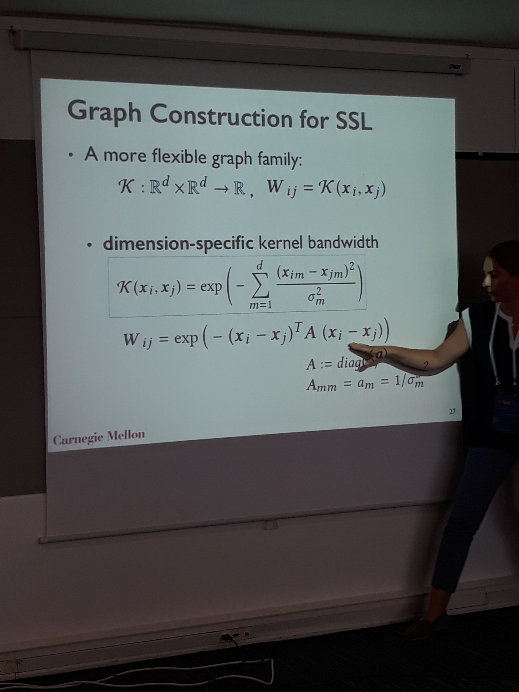   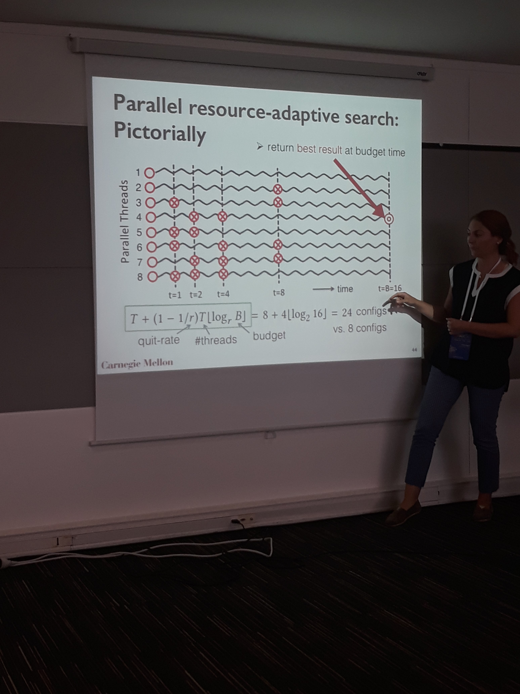 
    
  

### Normality for Attributed Networks
Most of the web networks can include node attributes, however, they are frequently overlooked because of the extra complexity. 
Prof. Akoglu's second presentation was on anomaly detection for supgraphs in attributed networks. Along with [Bryan Perozzi](http://www.perozzi.net/#sectionAbout), they devised a [normality measure](http://www.perozzi.net/projects/amen/) for attributed subgraphs, that combines structural density and attribute cohesiveness. It also takes into account boundary connections to hubs that do not really belong to the subgraph. By maximizing normality, one can recover the latent weights of a subgraph in the attribute space, so you can say things like "this community likes these stuff". This metric can be used for effective [summarization](https://dl.acm.org/citation.cfm?id=3139241) and [subgraph characterization](http://www3.cs.stonybrook.edu/~arezaei/project/amen_char.html). The latter was applied to a network of congressmen with attributes based on the policy areas of the bills they sponsor, and came up with the results below. 

 
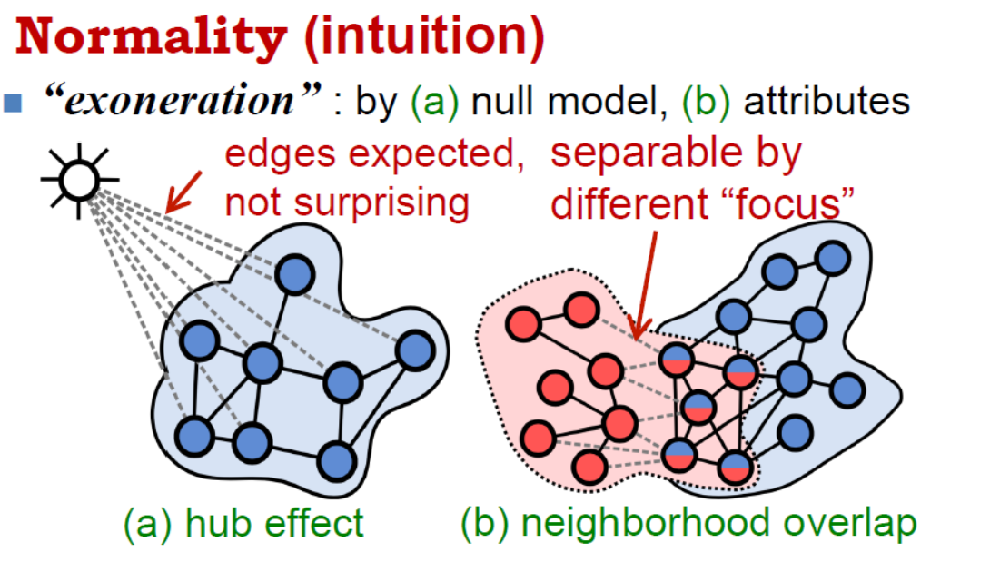 
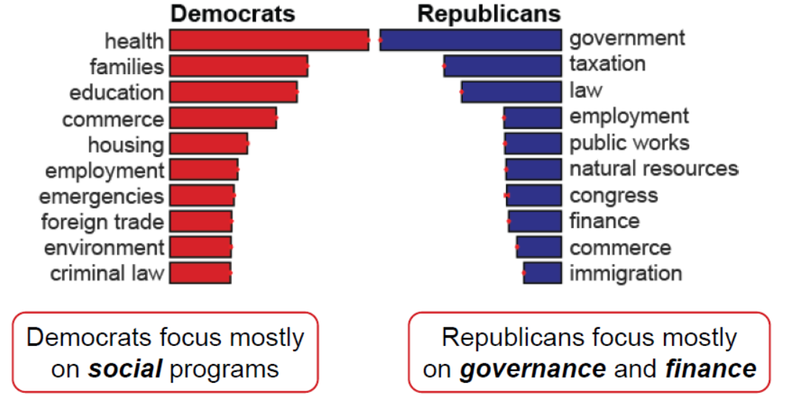 

       

### Temporal Networks as HONs

How to model networks that change in time is an open problem that was addressed by many presentations in the NetSci. [Ingo Scholtes](http://www.ingoscholtes.net/), who is known for his work on [higher order networks](https://arxiv.org/abs/1806.05977), presented two contributed talks during the satellites and one on the last day of the conference addressing this issue. His study contends that temporal networks should be addressed as a generative model for pathways, to account for non-markovian characteristics that are ubiquitous on most real-life networks. The idea is that retaining the order of the edges in the analysis may uncover latent causal relationships that would be overlooked otherwise. Prof. Scholtes' research reveals that analyzing a temporal network as a Higher Order Network (a hypergraph with short paths as nodes), can uncover meaningful patterns. 
There are two main shortcomings of this approach. The first is how to decide the optimal order of the network, and the second is how to take into consideration the actual underlying time between the edges. In other words, what is the length of the temporal paths that makes the analysis meaningful, and at what time range a path stops representing a causal relationship. Solutions to both have been proposed based on the entropy of the network in different orders and time scales, but there is still a considerable amount of ideas to explore.  

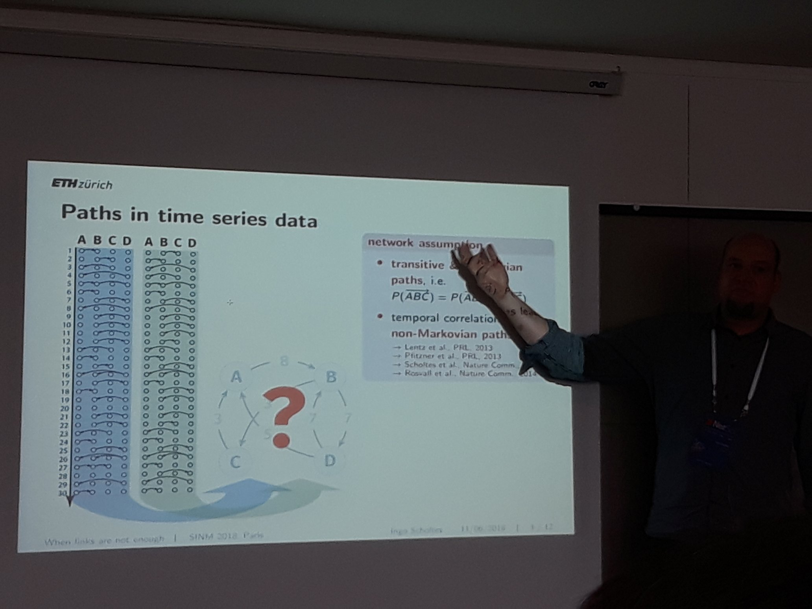   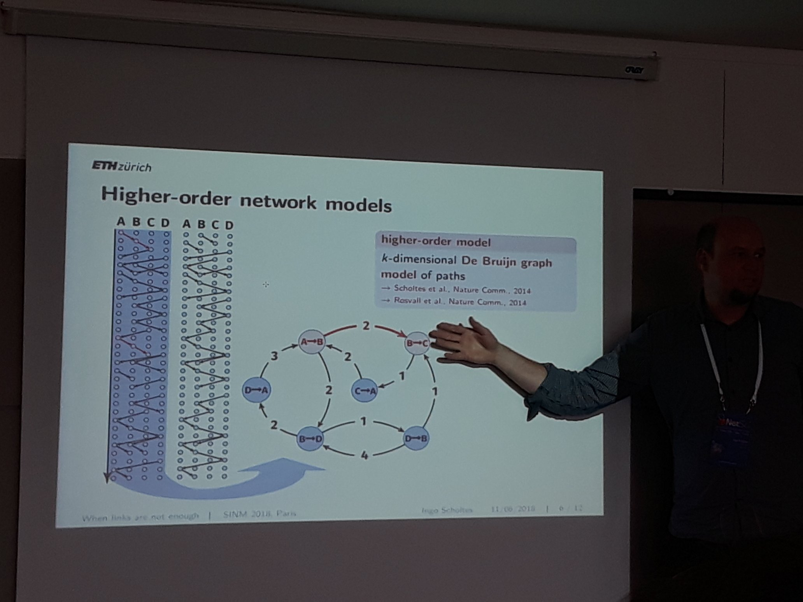 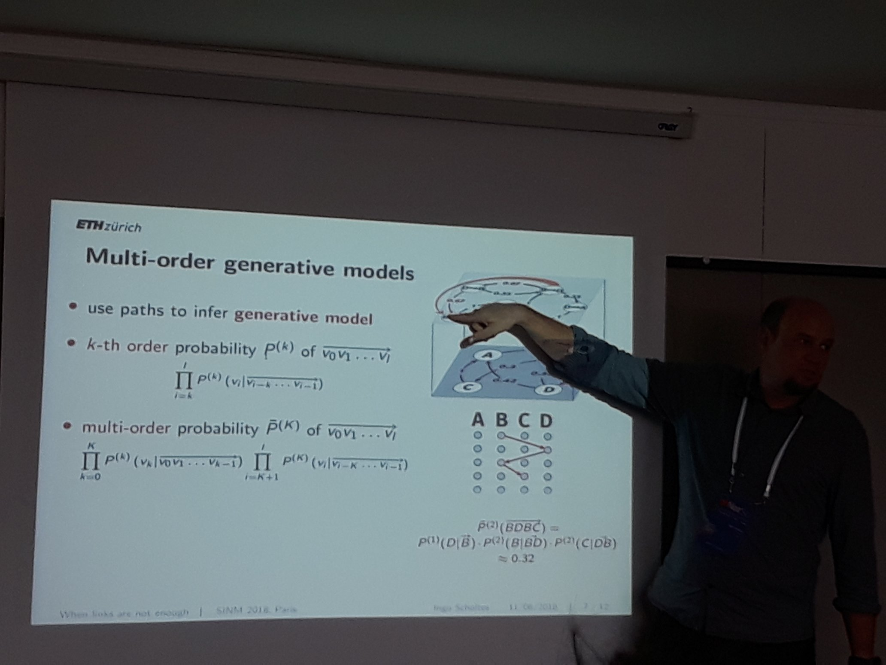

  

### Temporal Networks as Event Graphs

A temporal network can also be represented as a graph of events. Each edge in time is a unique event and is represented by a node in the event graph. A directed link corresponds to two adjacent events in time. The edges can be weighted based on the inter-event time, as in [Marton Karsai's](http://perso.ens-lyon.fr/marton.karsai/) presentation, or labeled based on the inter-event time and the type of temporal motif they form, as in [Andrew Mellor's](https://andrewmellor.co.uk/). This representation facilitates the investigation  of several patterns of a diffusion process. Some [examples](https://arxiv.org/pdf/1706.02128.pdf) are the time distribution for certain temporal motifs and the size of temporal components in different inter-event time scales.
It also facilitates examining [phase transitions](https://arxiv.org/pdf/1709.05647.pdf) of spreading processes on different thresholds of inter-event times, which in turn can shed light to which nodes contribute more to the contagion. Overall, event graphs are a rather exciting approach to analyze temporal networks that surely calls for further studying.

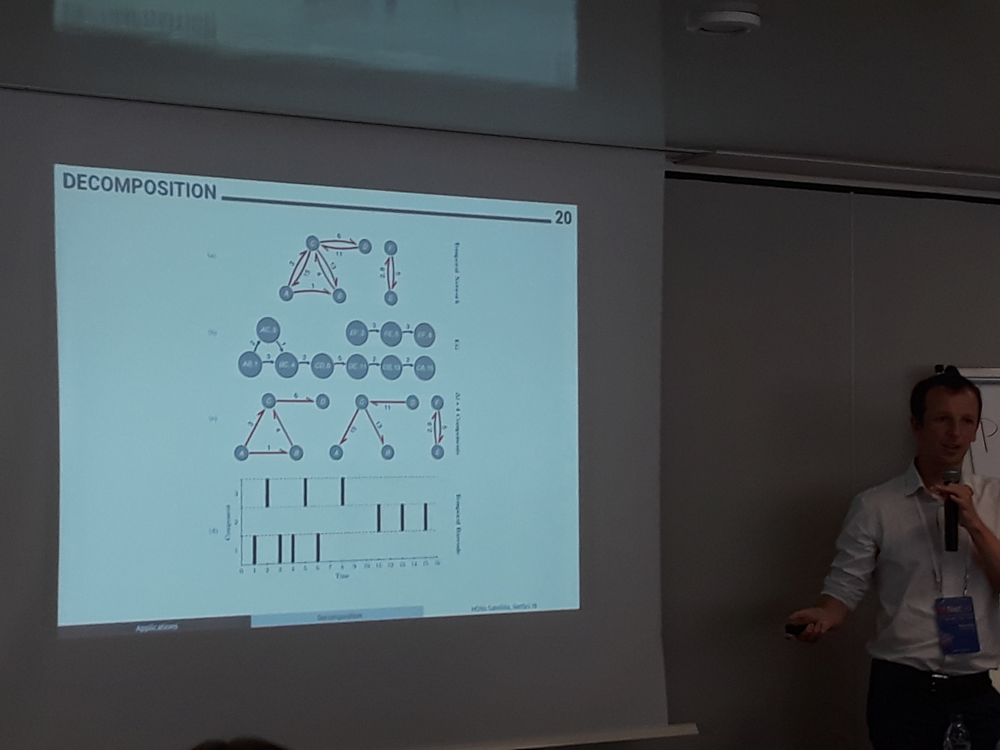   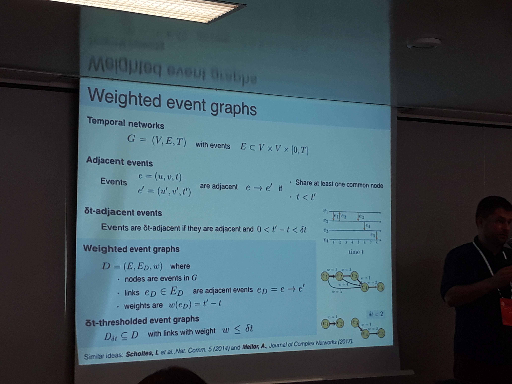 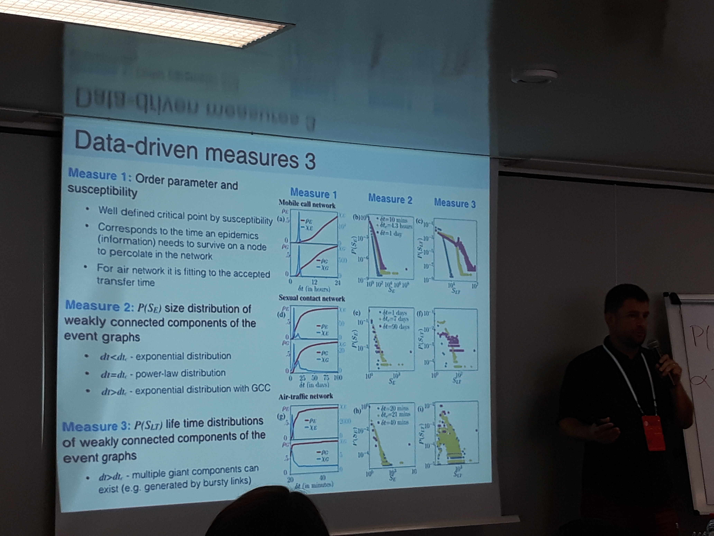

  

## Main Conference
During the main conference, I attended some of the keynotes and the sessions focusing on structure, theory and spreading. 

### The Spread of Misinformation in Social Media
[Fillip Menzcer](http://cnets.indiana.edu/fil/) gave a fascinating talk on several factors that facilitate the spreading of fake news. The abundance of news is itself a problem, because people tend to shallow information without validation, in order to consume as many news as possible and be up to date.
Segregation based on different opinions is another important factor. Prof. Menzcer demonstrated with a simulation, how unfollowing people with different opinions can lead to total segregation, and in tandem, the increase of misinformation inside each group.
Another problem Prof. Menzcer analyzed is how to battle [social bots](https://cacm.acm.org/magazines/2016/7/204021-the-rise-of-social-bots/fulltext).
Indiana University published [OSoMe](https://osome.iuni.iu.edu/), a set of tools that anyone can use for fact-checking on twitter. Hoaxy can help you track a tweet back to its initial source and Botometer can estimate the probability for a twitter account to be a bot. The latter needs some improvement, as it gave me a score of 4.3/5 (...or am I?).      
I had the chance to speak with Prof. Menzcer in the *chat with the experts* session, and he clarified that as in all adversarial cases, you can not completely eliminate the effect of bots, but you can minimize it. Another rather difficult problem is to identify people, sites, or organizations that try to debunk news that are actually true, because they serve particular interests. He himself was forced to defend the integrity of his research, when the Truthy project was [accused](http://www.sciencemag.org/news/2014/11/controversy-over-truthy-illustrates-power-social-media-inform-and-mislead) to support former president Obama. For additional information, you can check these Science articles on the [creation of fake news](http://science.sciencemag.org/content/359/6380/1094) and [the spread of lies](http://science.sciencemag.org/content/359/6380/1114.8).
  

### Bayesian Learning in Networks
[Tiago Peixoto](https://skewed.de/tiago), the creator of the handy [graph-tool](https://graph-tool.skewed.de/), gave two talks in the satellites and one in the main conference, all focusing on applying Bayesian inference in networks. 
The first [work](https://arxiv.org/pdf/1712.08948) argues that stationary Μarkov chains are not sufficient to generate a temporal network with realistic epidemic properties. Instead, a model is proposed where the edge probability distributions can change between different segments in time. The segments are inferred using Bayesian inference and Monte Carlo sampling. The second [talk](https://arxiv.org/abs/1806.07956) presents a hierarchical Bayesian methodology to address the problem of network reconstruction given noisy data with arbitrary errors. The network is expressed as a stochastic block model and the probabilities of missing or spurious edges are estimated using Bayesian inference. Some of this model's assets are its ability to infer communities during reconstruction and allow for error distributions that vary throughout the network. 
The final [presentation](https://arxiv.org/abs/1708.01432) was about stochastic block models for weighted networks. The weights are introduced to the standard SBM as covariates conditioned on the group structure. By employing microcanonical versions of the weights' distributions, the model allows expressing various types of continuous and discrete weights. 
The model's usefulness is exhibited in the analysis of migration, Congress votes, and brain networks. 

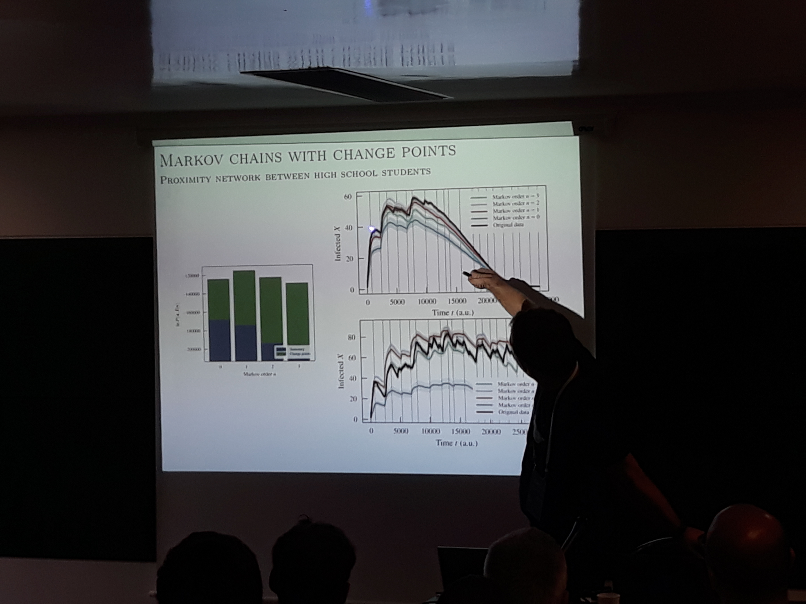  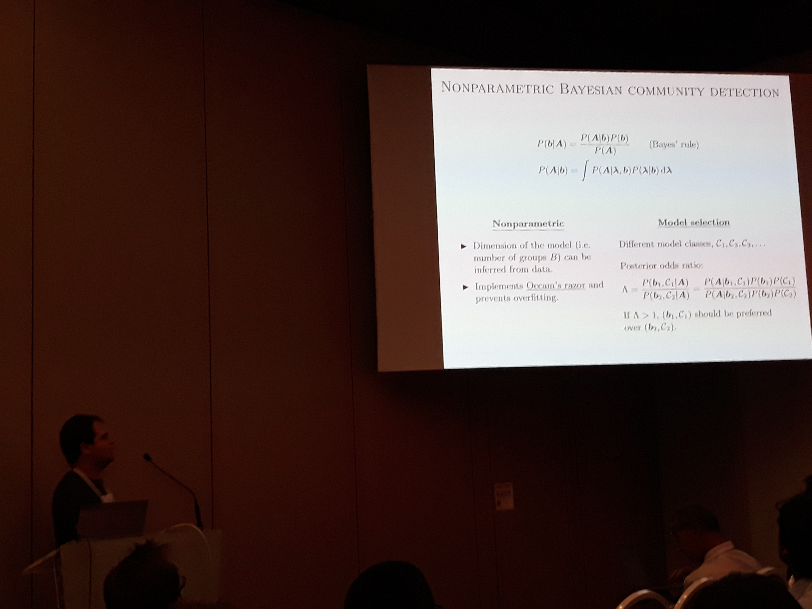   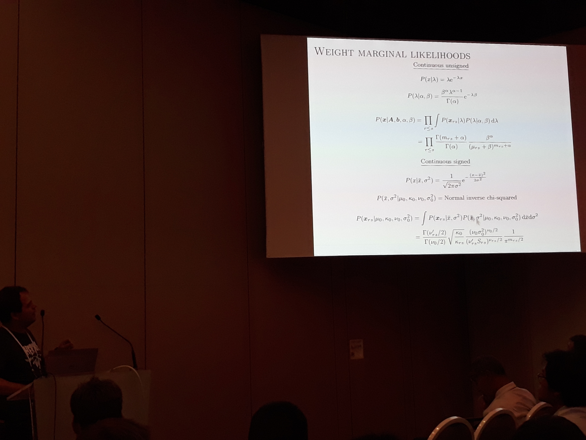
  
  

### Time-dependent Centrality
[Mason Porter](https://www.math.ucla.edu/~mason/) gave an insightful keynote talk about a new measure of centrality for temporal networks. The [presentation](https://www.slideshare.net/masonporter/centrality-in-time-dependent-networks) started with a brief review of the various centrality measures employed in network science, separating between those that are based on the graph's spectrum and the rest. 
Subsequently, Prof. Porter expressed the centrality of a temporal network binned in time windows as a supra-centrality matrix, following the multi-layer representation described in [Taylor et al.](https://www.ncbi.nlm.nih.gov/pmc/articles/PMC5643020/). The estimated time-independent centrality is computed through an involved singular perturbation expansion. 
This method was employed to analyze a network of universities, where a directed edge indicates a PhD student getting hired from a university after graduating from another. Using data from the [mathematics genealogy project](https://www.genealogy.math.ndsu.nodak.edu/), MIT was found by far the most central. On a related note, a [framework](https://arxiv.org/abs/1805.00193) to analyze temporal networks taking into consideration the actual underlying time was introduced. The key idea is to distinguish between the individual interactions which are instantaneous and the actual bonds which remain but change in time. In this framework, the bonds decay exponentially in time and increase incrementally with interactions. A time-dependent version of page-rank is developed that uses an adjacency-decay matrix and is computed through power iteration. Prof. Porter summed up by underlying the importance of taking into account the actual time when analyzing networks. After a question from the audience, he also pointed out on the usefulness of Hawkes processes. I was wondering why this model was somewhat underrepresented in NetSci, as it has been employed in several great works in network analysis lately, two examples being [Linderman et al.](http://proceedings.mlr.press/v32/linderman14.pdf) and [De et al.](https://people.mpi-sws.org/~manuelgr/pubs/opinions-nips16-main.pdf). 

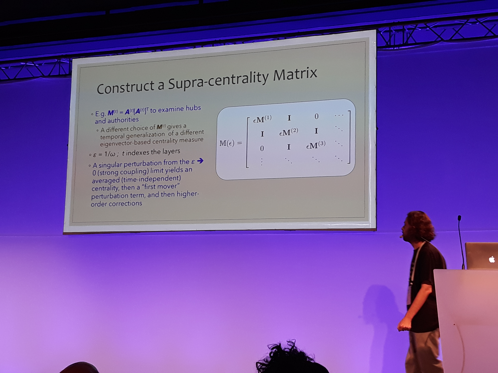   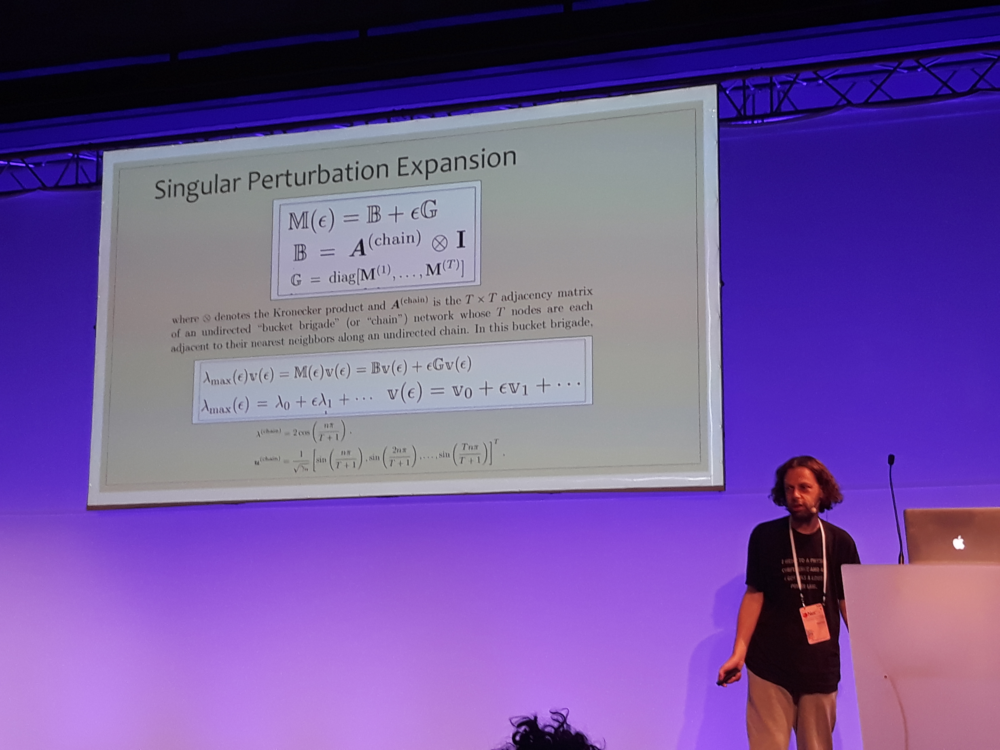 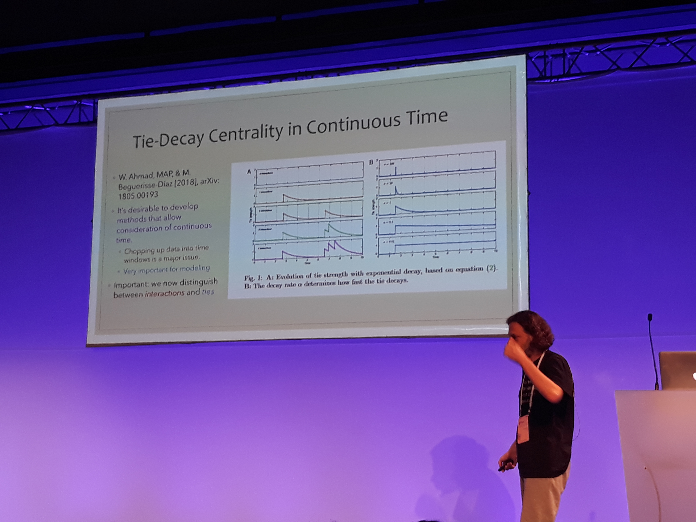 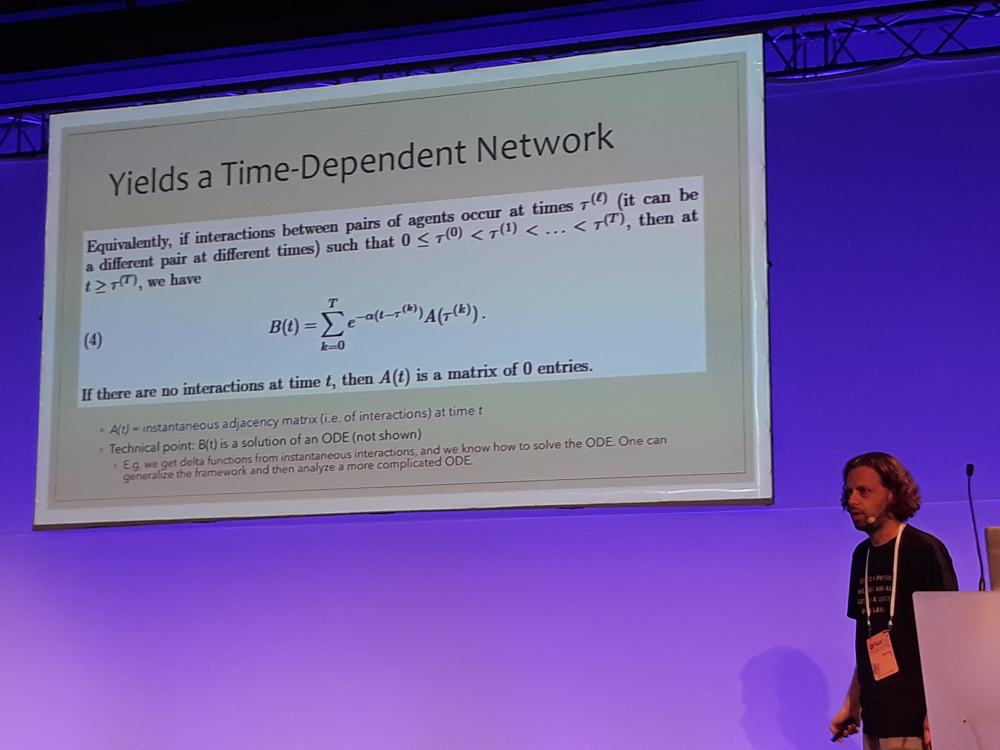
  
  

## Other interesting talks
* [Bailey Fosdick](http://www.stat.colostate.edu/~bailey/) introduced a novel [method](https://arxiv.org/abs/1609.02629) for network inference from event data. In contrast to other point-process models, this method does not consider the count of interactions indicative of the edge's strength and connects hierarchically the modeling of interactions with the latent network. <!---The interactions between each node pair is an inhomogeneous Poisson process with intensity conditioned on the latent edge, which is a stationary continuous-time Markov chain with binary state.--->

* [Austin Benson](https://www.cs.cornell.edu/~arb/) suggests that local clustering coefficients should not be limited to triangles. His [work](https://www.cs.cornell.edu/~arb/papers/higher-order-clustering-PRE-2018.pdf) on extending traditional graph clustering metrics to include higher order information, indicates that numerous real-world networks exhibit forms of clustering that go beyond triadic closure. 

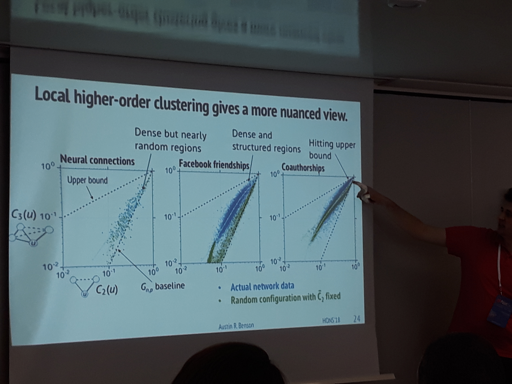   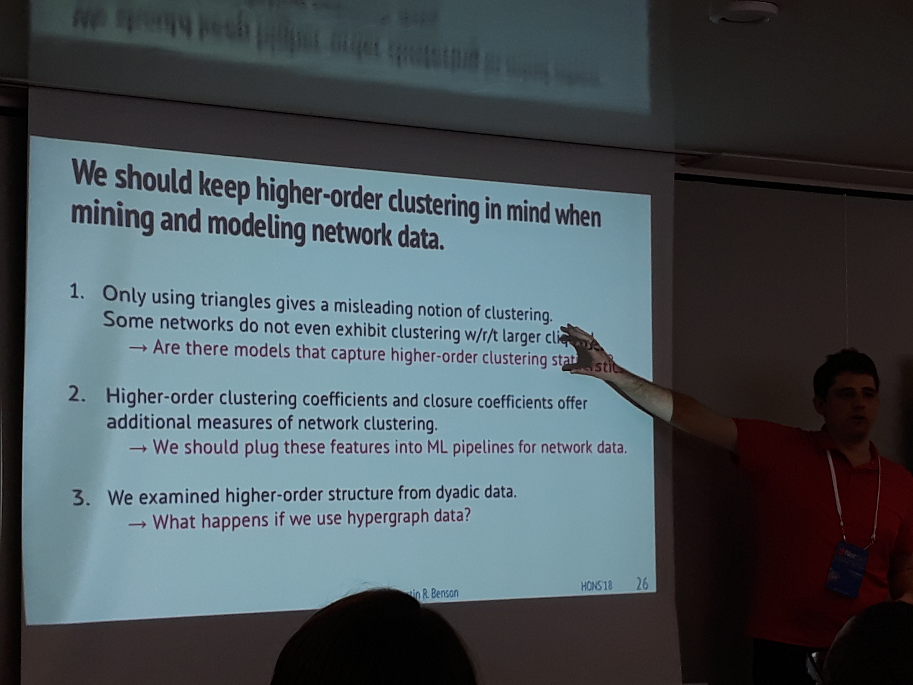

* [Bruno Ribeiro](https://www.cs.purdue.edu/homes/ribeirob/) proposes a method to predict connections between subgraphs in time evolving networks. The [Sugraph Pattern Neural Network](https://www.cs.purdue.edu/homes/ribeirob/pdf/Meng_SPNN_AAAI2018.pdf) takes as input a higher order network and predicts future links. In this HON, each node is a subgraph of the initial network and an edge is defined based on the node overlapping between the two subgraphs.

* [Veronica Vinciotti](http://people.brunel.ac.uk/~mastvvv/) presented a nuanced [statistical model](https://arxiv.org/abs/1710.10319) to identify overlapping clusters on a bipartite actor-event graph. A vector indicating the soft assignment of each actor in a cluster is inferred with Bayesian inference. One of the key ideas is to expand the standard hard assignment vector into a matrix that can contain all possible assignments.

* [Victor Veitch](http://victorveitch.com/) presented a methodology to express empirical risk minimization (ERM) in the context of graph learning. [Relational ERM](http://www.victorveitch.com/assets/pdfs/relational_ERM.pdf) leverages on sampling techniques to address the theoretical hinders of statistical learning for graphs, and has a state of the art performance in semi-supervised node classification.

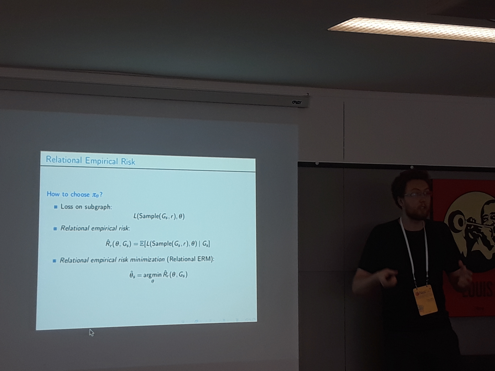   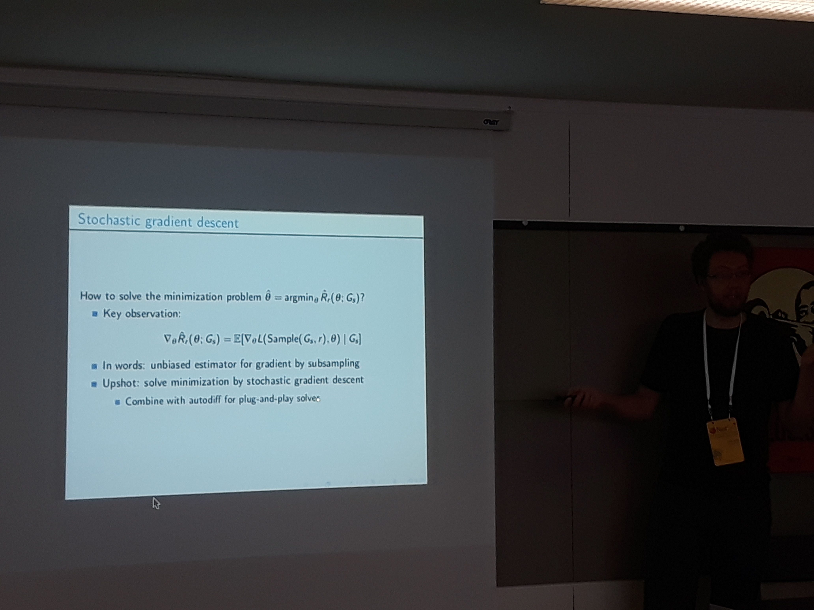

* [Nynke Niezink](http://www.stat.cmu.edu/people/faculty/nynke-niezink) 
 modeled a temporal social network with nodal attributes using a continuous-time Markovian state space model. She demonstrated the effectiveness of the model with a cool analysis on the role of low self esteem on being influenced to drink alcohol.

* [Yifan Qian](https://haczqyf.github.io/) experimented by randomizing the features and the graph that serve as input to a Graph Convolutional Network and logging its performance. He found out that both types of input play an almost equally important role, on experiments with a citation network.

* [David Choi](https://www.heinz.cmu.edu/faculty-research/profiles/choi-david) presented a [statistical model](http://www.pnas.org/content/early/2018/01/10/1718449115) that uses a smoothing technique on the spectrum of a temporal network, to identify when the communities change or their structure is prolonged. The effectiveness of the method is tested on a genomics dataset. 

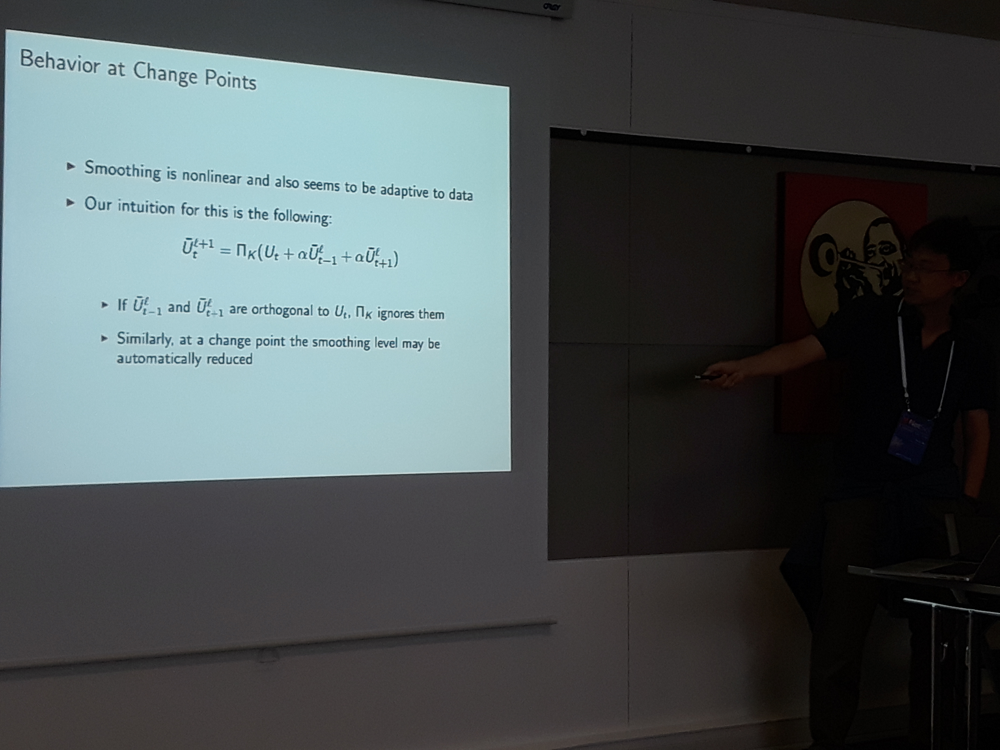   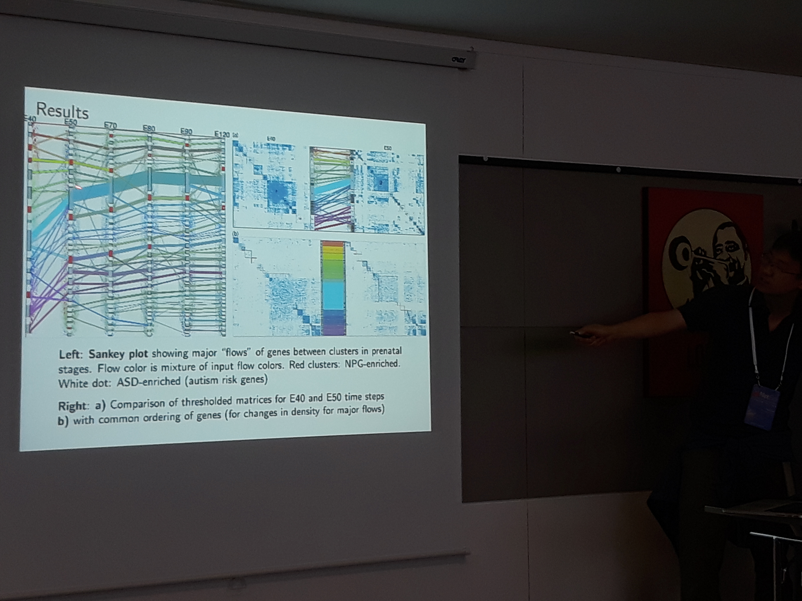

* [Sean Cornelius](https://www.barabasilab.com/people/sean-p-cornelius) presented a [study](https://arxiv.org/abs/1607.06168) on the controlability of temporal networks. The analytical results, which are backed up by experimental observations, indicate that temporal networks can be controlled faster and easier then static ones. Temporality is a blessing in disguise!

* [Ulf Aslan](http://ulfaslak.com/) presented a [method](https://arxiv.org/abs/1711.07649) to identify communities that reoccur in a temporal network. In summary, the network is binned into static instances and edges are drawn between different instances of the same node. The edge weight is proportional to the Jensen-Shannon similarity between the node's ego-networks, which allows to find whether structures are repeated. 

  
<!---!

[Michael Schaub](https://michaelschaub.github.io/)

[yan leng](http://web.mit.edu/yleng/www/yleng.html) Bayesian learning

http://www.andrew.cmu.edu/user/lakoglu/docs/18-NetSci-sinm-glearnssl.pdf  are available :) .
http://www.andrew.cmu.edu/user/lakoglu/docs/18-NetSci-mlns-attributed.pdf
--->

## Conclusion

NetSci, as its name suggests is centered around models that capture patterns in complex networks. From network centralities to community detection methods, in computer science terms most of these models would probably belong somewhere between graph algorithms and unsupervised machine learning.
Lots of talks and posters focused on tackling problems relevant to temporal networks, like tracking subgraphs in time or analyzing evolving processes. Another very active branch is the analysis of multiplex networks, where nodes connected in numerous different aspects are stacked in layered representations of networks. 
There are also very interesting ongoing works on statistical and machine learning techniques for network analysis. In general, however, network analysis based on machine learning (especially supervised) is not as prevalent as one would assume. The majority of network science models are built based on intuition and knowledge from observed patterns. However, real-world data exhibit an enormous amount of network-specific properties that call for data-driven approaches. 
In addition, I expected to see algorithmic complexity analysis in more talks. Although the models were very imaginative and sophisticated, few works addressed scalability issues. On the upside, the range of applications was enormous. From genomics and connectomics to bank loans and plant ecosystems, I started to believe almost anything can be analyzed as a network.         
As a final note, big applause to [Vittoria Coliza](https://www.epicx-lab.com/vittoria-colizza.html) and [Alain Barrat](http://www.cpt.univ-mrs.fr/~barrat/), 
who did an excellent job on organizing the whole conference, that reached nearly 800 participants. You can also check Luca Maria Aiello's [blog post](https://medium.com/@lajello/network-wanderings-in-paris-netsci-2018-df331a3fa93e), that provides a very nice summary of the conference proceedings. 