*George Panagopoulos, December 14, 2018*

This December I had the chance to visit Cambridge, where the [Complex Networks](https://www.complexnetworks.org/) took place, to present our work on [influence maximization](https://link.springer.com/chapter/10.1007/978-3-030-05411-3_32).
It is a young but promising conference that comprises mostly of a blend between physics and computer science papers. I attended the tutorials, keynotes and the sessions on epidemics and machine learning.Below is a write-up that summarizes the most interesting ideas I came across.   

## Contents
1. Tutorials 
	- Egonetwork Analysis
	- Epidemics 
4. Keynotes
    - Network polarization
	- Fake news and kcore
	- Network motifs  
5. Talks
6. Conclusion

## Tutorials 

### Clustering egonetworks leads to better clustering overall
Have you noticed how clustering small networks tends to be easier then big ones? 
Dr. [Silvio Lattanzi](https://sites.google.com/site/silviolattanzi/)'s experiments using [conductance](https://en.wikipedia.org/wiki/Conductance_(graph)) for clustering evaluation showed that clustering nodes in egonetworks produces more accurate results than clustering the whole network. Intuitively, clustering in the microscopic level makes sense because the neighbors of a node tend to be connected in a more consistent manner. A plot of conductance relative to the cluster size reveals how the quality of the clusters increase up to a point but then decreases, as the giant connected component emerges. This indicates the well known octopus structure of real world networks, that consists of a tightly knit core and several whiskers.   
Thus, we want to somehow use ego-network clustering to improve the general clustering of the network, and a promising idea towards this is the persona graphs. A persona graph is basically a cluster of a node's egonetwork ,severed from it. A copy of the ego-node is created and connected to the nodes of this cluster, resembling the initial node. Applying this transformation for all clusters of all egonetworks facilitates the integration of the micro-clustering into the network. Subsequently, an overlapping clustering method can produce remarkable results in networks that would be impossible to cluster in their initial forms.     
 

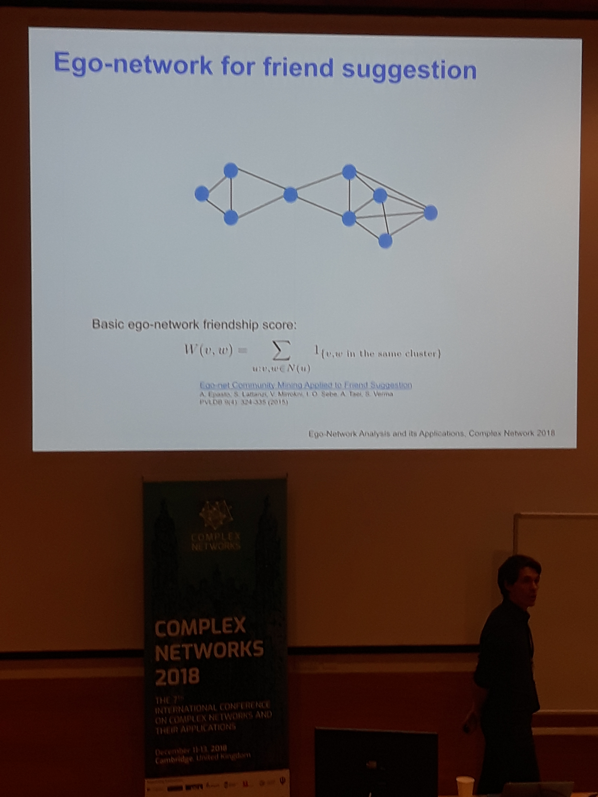   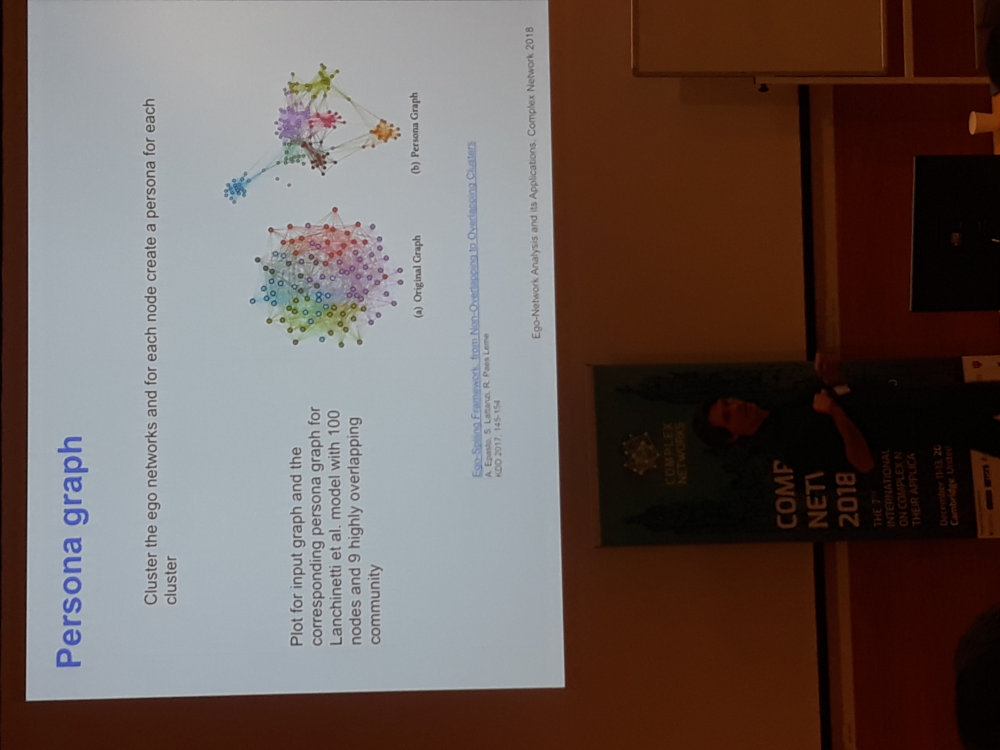  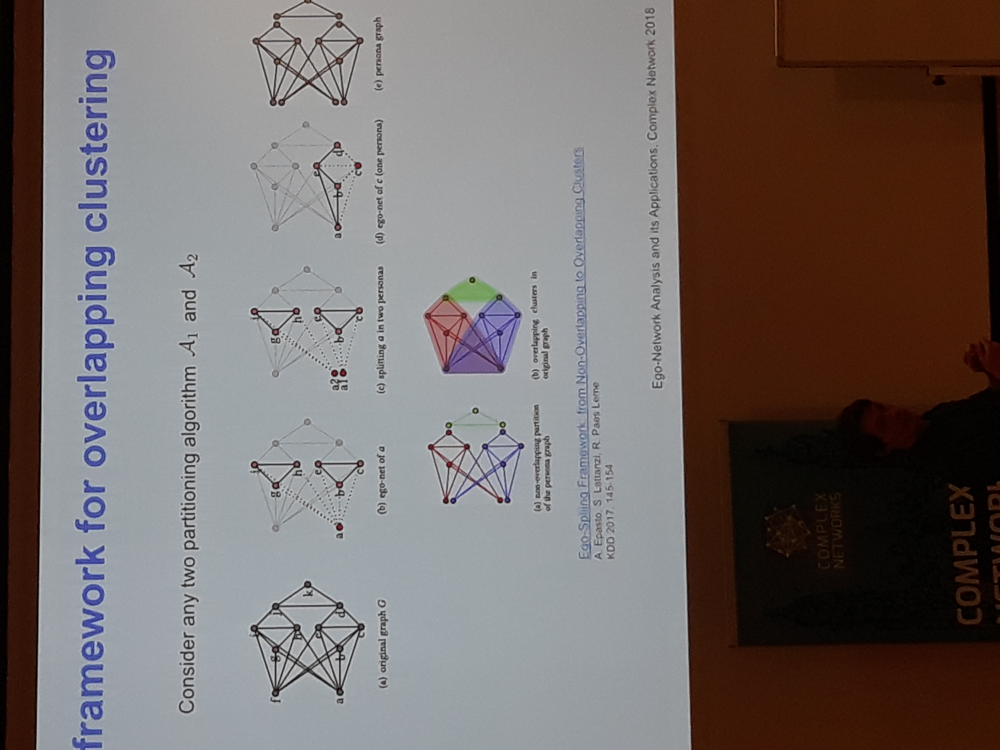

   
  

### Epidemics using metapopulations and mobility history
After a general intro to epidemiology and compartmental models, Prof. [Jesus Gomez Gardenez](http://complex.unizar.es/~jesus/) presented an adaptation of the SIS model into networks that include additional information such as metapopulations and history of movements of the nodes. More specifically, each node can belong to a certain metapopulation e.g. a person in a city, and can move to other cities but has to come back to its initial city eventually. The model defines the probability of a node being infected based on the distribution of the infected nodes in its metapopulation at a given time step. This probability breaks down to the probability of staying infected and getting infected. The latter is defined based on the typical probability of a node getting by its neighbors. Note that in this way a node might get infected by a certain metapopulation which it is currently in, even if it belongs to another one. This is modeled using the logs of the nodes' mobility, which indicate how a node moved from one metapopulation to another. The results are remarkable because they reveal that movement between metapopulations during an epidemic might actually hinder the epidemic, which comes in contrast with the general belief.

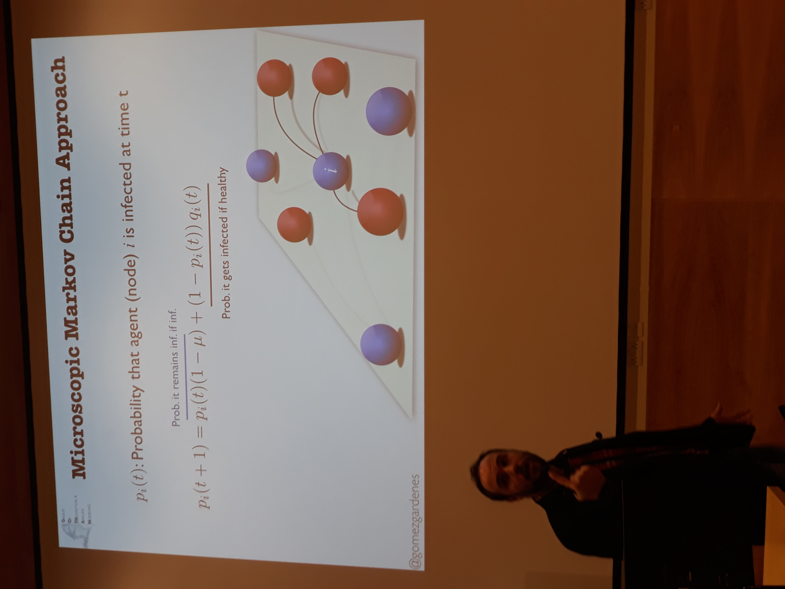   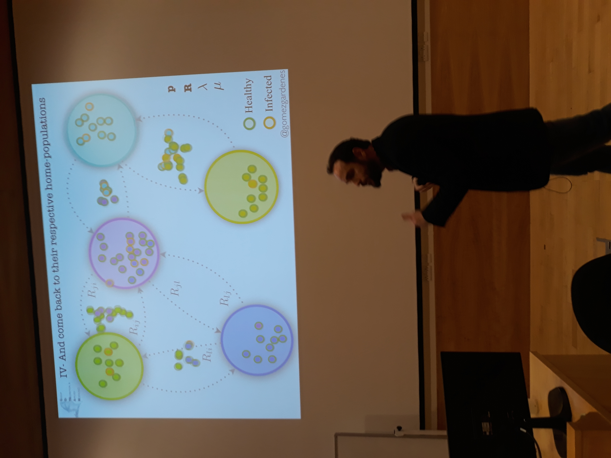  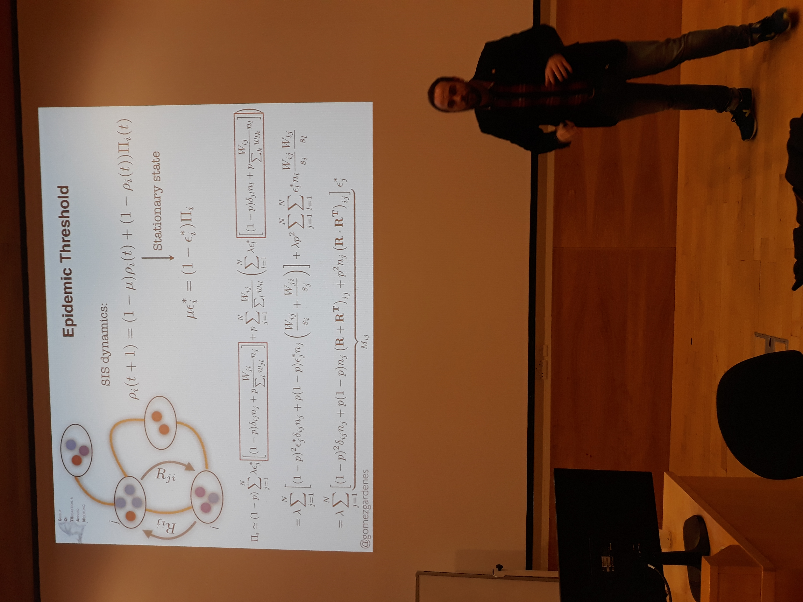

   
  

## Keynotes

### Battling polarization by reducing echo chambers
Diversity of opinions is important for a healthy society. The social media however, tend to enforce echo chambers by providing feed that resembles the content the user shares. In other words, the user expresses her opinions and reinforces them through same-content feedback. This effect can dramatically increase [polarization](https://www.aaai.org/ocs/index.php/ICWSM/ICWSM11/paper/viewFile/2847/3275) in social media.
The data analysis show that this effect really exists, so how an we battle it?
Prof. [Aris Gionis](https://users.ics.aalto.fi/gionis/) proposes to develop tools that allow a user to visualize the ideology space of the network and her position in it. In this manner she can judge whether she should diversify her feedback or not.  
One approach towards this is managing the diffusion of two opposing campaigns, such that the influence exerted to the nodes will be as balanced as possible. This setting is related to the problem of influence maximization, but instead of choosing the optimum seed set,the aim is to break it into two different sets that can each transmit information from opposing sides. The optimum solution will lead to opposing diffusions that can have an equal effect on all users.
Another solution is to change the recommendation process in a more direct manner. Assuming that the adoption of an opinion (or an item) in the network follows an independent cascade model, the probability of influence can depend on the item preferences of the user and the respective item being propagated. In this way, one can optimize the propagation such that a user is exposed to all types of items in an equal amount.       

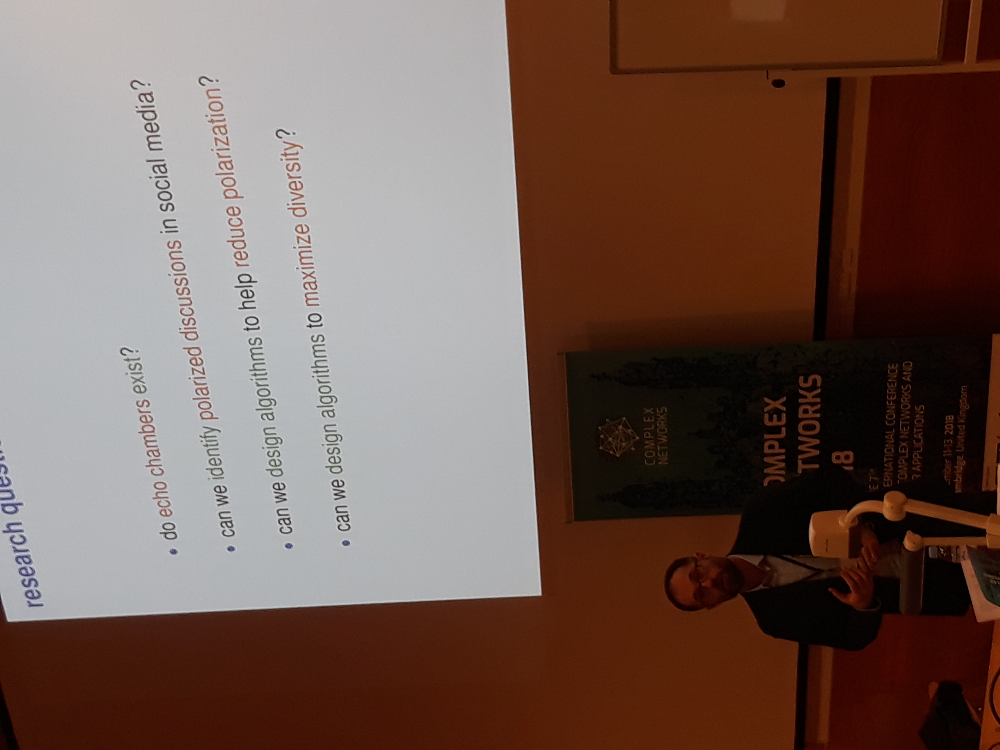   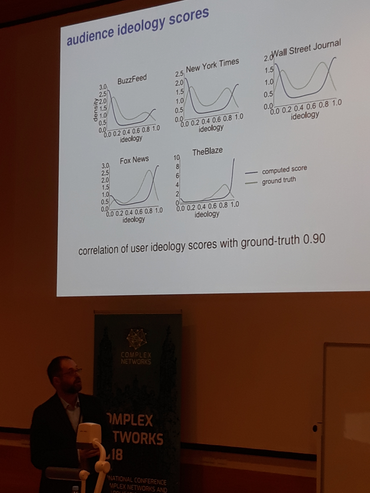  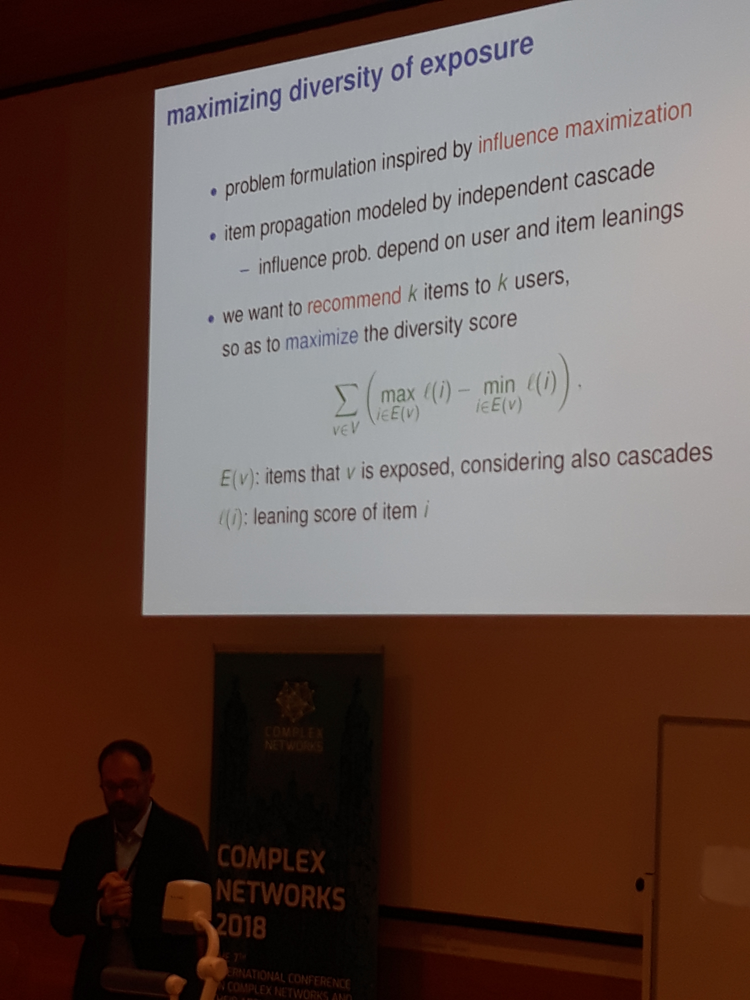

   
  

### Influence of the fake news in 2016 US election
Prof. [Hernan Makse](http://www-levich.engr.ccny.cuny.edu/webpage/hmakse/)'s presentation was divided in three parts. 
The first part was theoretical, and described how influence maximization can be approached from the perspective of optimal percolation, which surprisingly identifies as influencers weakly connected nodes that are surrounded by hubs, a case that other heuristics overlook. 
The next part consisted of an analysis of twitter during the 2016 US election. After showing that one could predict the voting intention through tweets, Prof. Makse presented a thorough analysis based on causal relationships between the tweets of different influencers. This uncovered the relationship between certain republican influencers and twitter accounts that are associated with fake news.  
Last but not least, he presented a framework for analyzing ecological networks, whose steady state relies on the links of the networks' k-core. Intuitively, this means that the stability of an ecosystem relies on the interactions between certain subspecies. Moreover this approach reveals that too much diversity and mutualism could destabilize an ecosystem.  

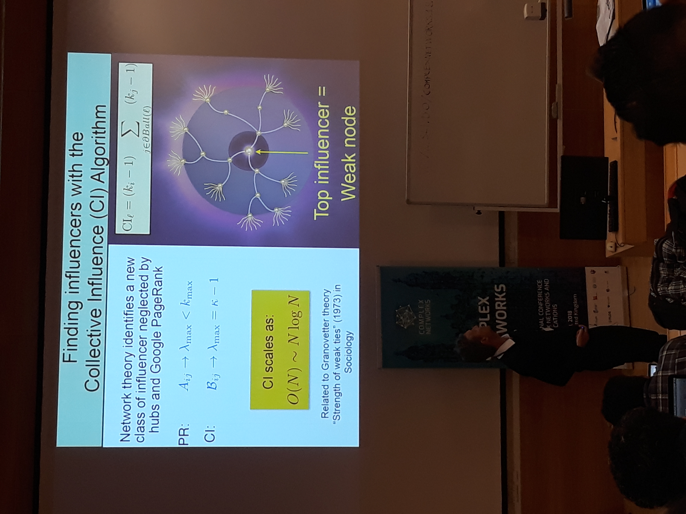  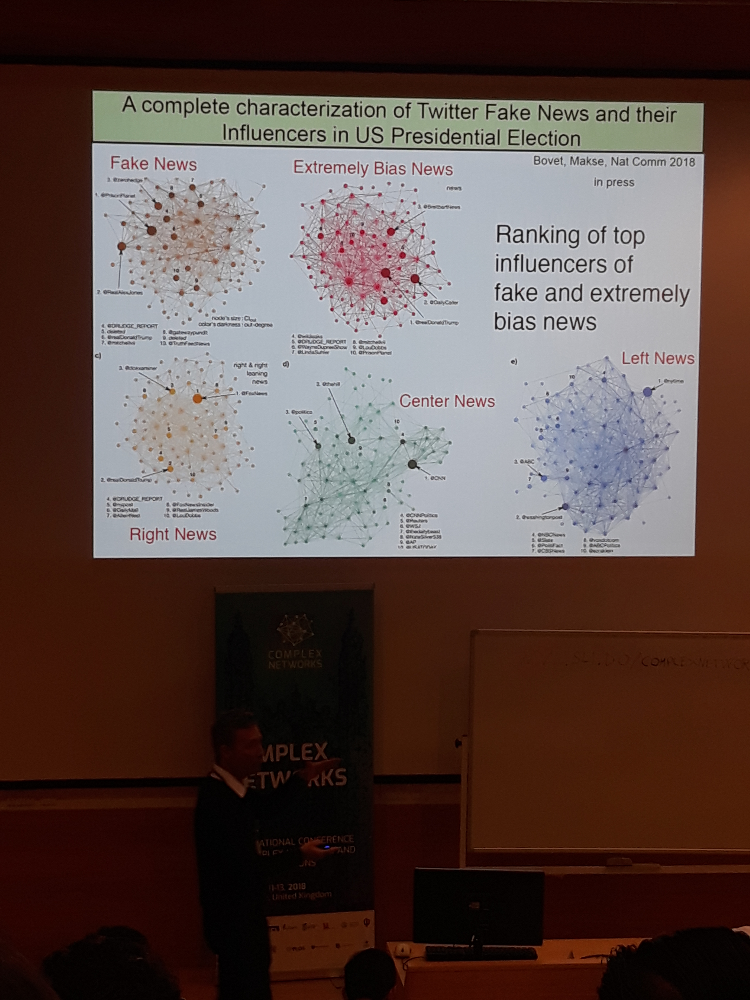  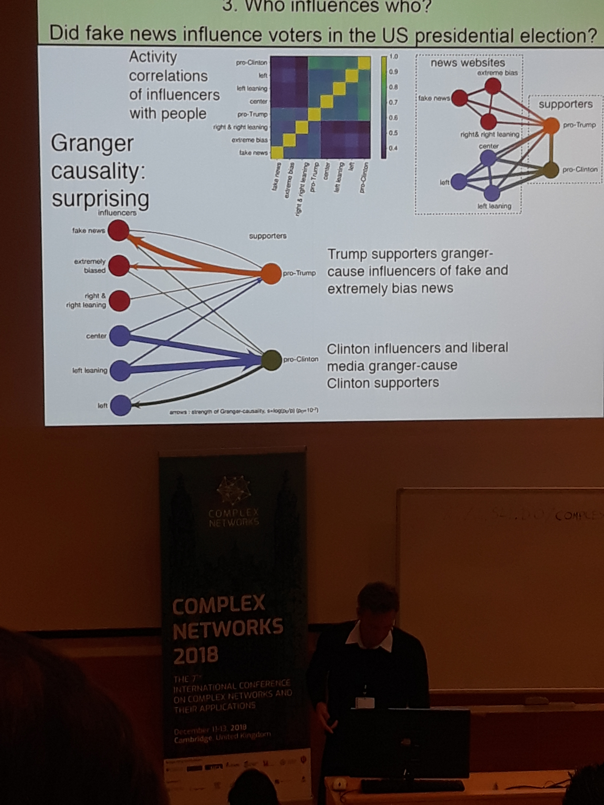 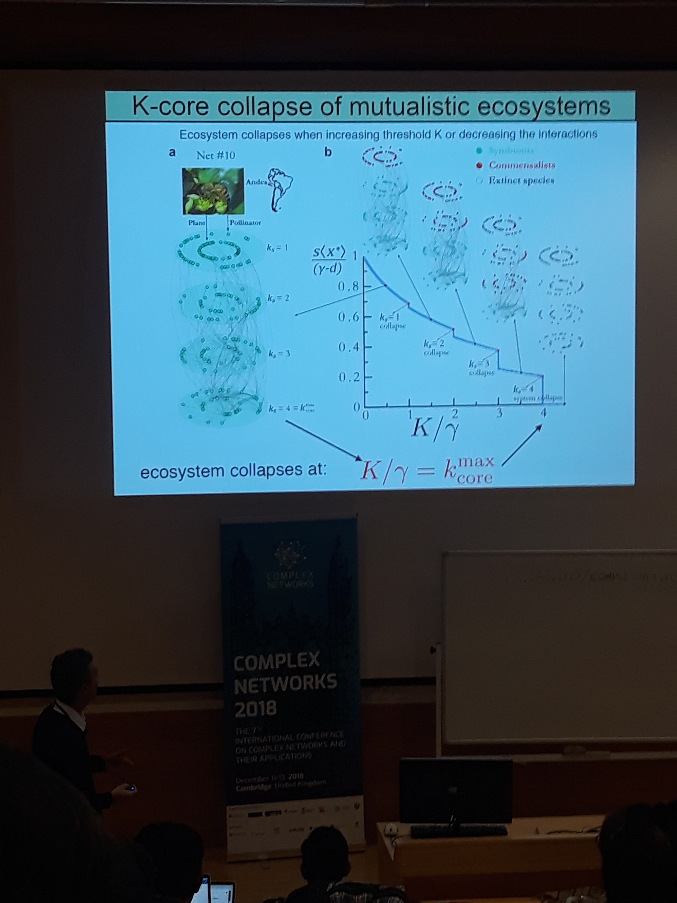 

   
  

### On the impact of network motifs in network classification 
Prof. [Don Towsley](https://www.cics.umass.edu/faculty/directory/towsley_donald) presented a keynote on networks motifs. Motifs are patterns that capture the interactions of a social network's users in a micro level.
The possible combinations that can be examined are limitless, but most studies focus on certain motifs comprised of different directed versions of dyads and 3 or 4-cliques, as they can be interpreted based on computational sociology principles.
The main subject of this study was to examine whether certain motifs occurence is significantly higher then random in different types of networks.  
The results show that networks do exhibit a significant amount of certain motifs, such as mutual dyads and 3-cliques. You can also observe other types of triads such as a transitive triad (one node points to two others and they point to each other) or an incomplete 3 clique. Full triads are very prevalent while cyclic triads are very rare.
Examining the correlation of motifs between networks, we can see that certain patterns are prevalent in specific networks.  
This motivates the idea to use the motifs for network classification.
Towards this, prof. Towsley's team performed a classification experiment, using embeddings and features from different types of networks (follow, friendship, advice etc..) as input to strong classifiers such as XGBoost and SVM.
The accuracy increases significantly when the input includes information based on motifs, underlying their role in the network's identity. The networks examined through these studies were very small (30 to 2500 nodes). The final part of the lecture addressed the issue of scalability, and the proposed solution is based on a strategic sampling of edges that could lead to unbiased estimates.

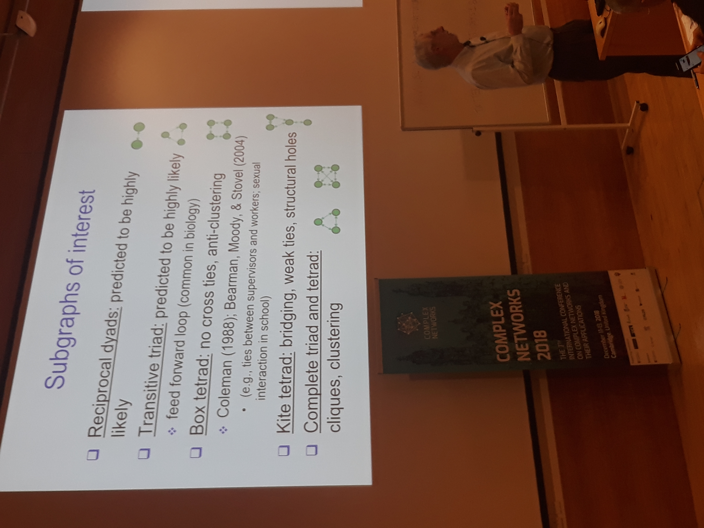   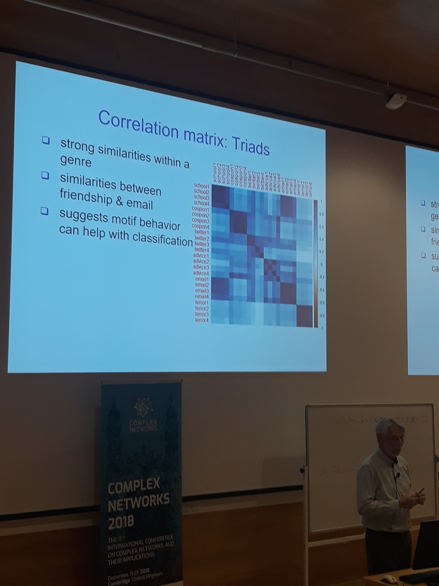  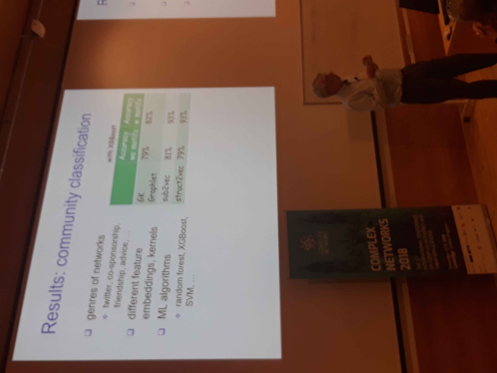

   
  

## Talks
* Julien Petit's [temporal random walk](https://arxiv.org/abs/1809.02540) that takes into account three different time scales to model apart from the waiting time of a node, when the edges start and stop.   

* Xutong Liu's [work](https://arxiv.org/abs/1810.03078) in predicting the graphlet count of a network using neural networks. 

* Shankar Lyer's [analyses](https://research.fb.com/publications/the-costs-of-overambitious-seeding-of-social-products/) revealing that promoting a product too fast and at too many people may actually have negative results in its success.

* Ilias Sarantopoulos presented a [method](https://link.springer.com/chapter/10.1007/978-3-030-05411-3_28) for detecting and tracking communities that evolve in time.
 
* Hafizh Adi Prasetya devised an independent cascade [model](https://www.researchgate.net/publication/329425399_Modeling_the_Co-evolving_Polarization_of_Opinion_and_News_Propagation_Structure_in_Social_Media_Volume_2_Proceedings_The_7th_International_Conference_on_Complex_Networks_and_Their_Applications_COMPLEX) that takes into account the effects of polarization exhibited in real social networks.

* [Kaushalya Madhawa](http://kaushalya.github.io/) created an algorithm to estimate the expected degree of a partially observed network using online learning.  

* [Ferenc Beres](https://ferencberes.github.io/) online algorithms to derive node embeddings from networks that evolve. 

* [Arya McCarthy](https://aryamccarthy.github.io/) tailored the no free lunch theorem for community detection.

* Sergio Gomez suggests a [method](https://arxiv.org/abs/1711.10443) to measure the importance of a link in an epidemic, which can be used to contain an epidemic outbreak. 

* [Alexandre Bovet](https://alexbovet.github.io/) performed a very interesting analysis using causal network reconstruction on twitter activities and revealed that the republicans were influenced more by fake news accounts than the democrates.
 

## Conclusion
Overall, the conference comprised more of simulation models and analyses than algorithmic works.
I saw some very impressive spreading simulation techniques, which tackle more and more assumptions in an effort to approach realistic results. Although these models can be used to provide valuable insights on the network's mechanics, data driven evaluations of the model's accuracy are quite rare and would be a nice addition. Moreover, though there were a few papers based on representation learning, the number of centralities and heuristic techniques greatly surpass that of machine learning models. With the advent of Graph Neural Networks and generally network representation learning the past years , it would be beneficial for both communities to compare these different approaches as much as possible. 
Apart from research, Cambridge is beautiful during Christmas and I was glad to see so many people that I met in the NetSci 2018.

 
 
