*George Panagopoulos, December 25, 2019*

## Introduction
In this exploratory analysis, we aim to examine the collaborations patterns between French and USA institutions. A collaboration is defined as a paper where at least one author comes from a French institute and at least another one comes from a US institute. Towards this, we capitalize on the [Microsoft Academic Graph](https://www.microsoft.com/en-us/research/project/microsoft-academic-graph/), the largest open bibliographic dataset that contains detailed information for authors, publications and institutions. In order to map affiliations to either France or USA, we utilized the python [geopandas](http://geopandas.org/) library that contains latitude and longtitude of the world map. In cases where the coordinates of an affiliation were not available in the database, we used its 
wikipedia url and named entity recognition to identify the country of its address in the wikipedia page. 
Overall, institute names tend to be quite volatile (due to university federations created) in the last decade mostly in France, so this is a best effort trial. 

## Analysis
### Top Academic Institutes
Among the French academic institutes that collaborate with USA we report in Table 1 the 10 most productive (in terms of number of papers) and their most frequent collaborators in the USA. Figure 1 visualizes the same information with a chord plot, where the edges are colored based on the US institutes. The figure shows the US universities collaborating mostly with the aforementioned most productive French institutes, with Harvard and MIT standing out with more than 3 inter-university collaborations.

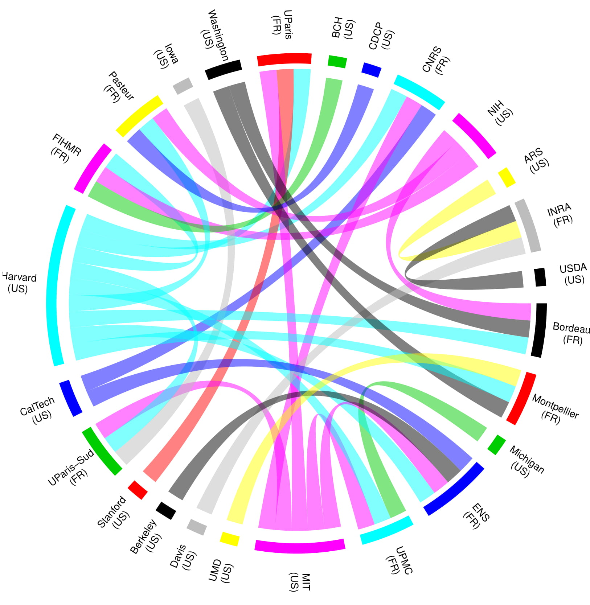  

   
*Figure 1. Table 1 visualized in a chord plot*
  

| **France**   | **USA**   |
|---|---|
|Centre national de la recherche scientifique (CNRS) | California Institute of Technology (CalTech) [2678]   Massachusetts Institute of Technology(MIT) [2226]   Harvard University [2106]| 
|French Institute of Health and Medical Research (FIHM) | Harvard University [1765]   National Institutes of Health (NIH) [1484]   Boston Children's Hospital (BCH) [1053]|
|University of Paris (UParis) | Harvard University [2061]   Stanford University [1486]   Massachusetts Institute of Technology (MIT) [1280] |
|École Normale Supérieure (ENS) | Harvard University [276]   Massachusetts Institute of Technology (MIT) [252]    University of California, Berkeley [247]| 
|Institut National de la Recherche Agronomique (INRA) | University of California, Davis [255]    Agricultural Research Service (AGS) [255]   United States Department of Agriculture (USDA) [244] |
|Pierre-and-Marie-Curie University (UPMC) | Massachusetts Institute of Technology (MIT) [769]   Harvard University [761]   University of Michigan [670]|
| University of Bordeaux|Harvard University [335]    University of Washington [277]   National Institutes of Health (NIH) [212]|
| University of Paris-Sud | Massachusetts Institute of Technology (MIT) [1327]   Harvard University [1305]   Iowa State University [1093]|
|University of Montpellier | University of Washington [230]   Harvard University [219]   University of Maryland, College Park (UMD) [211]|
|Pasteur Institute | National Institutes of Health (NIH) [561]    Harvard University [421]    Centers for Disease Control and Prevention (CDCP) [313]| 

  *Table 1. THe 10 most productive french institutes and their top 3 USA collaborators.*

### The timeline of French - US  academic collaborations 

The oldest collaboration between a French and a US institute dates back to 1930, with a joint paper between Ecole Normal Superiere and Cornell University: Ch. Porcher, L. Maynard. LA GRAISSE DU SANG ET LA GRAISSE DU LAIT PENDANT LA
LACTATION. Le Lait, INRA Editions, 1930, 10 (96), pp.601-613. ffhal-00894993.
Since then, the number of collaborations, as well as their impact (in terms of citations) have increased significantly, as one can see in Figure 2.
Moreover, there is an almost exponential increase in the number of papers produced by joint collaborations. The same applies to the impact of these works, which increases especially until 2010. Naturally, the citations count in recent years is diminished, as young papers have fewer citations and they need time to get cited. There are also some monumental years, such as 2012, where the inclusion of the publications on the discovery of the Higgs Boson particle has produced a massive number of citations. 

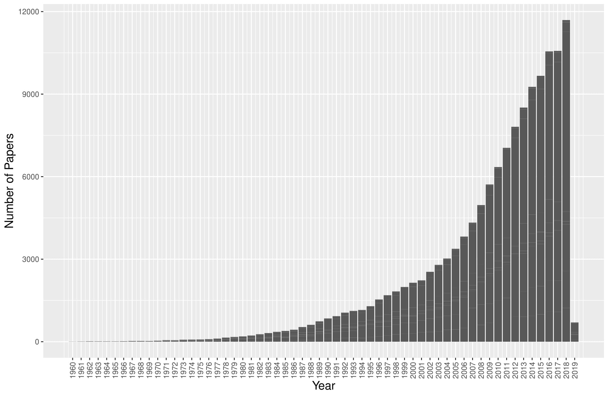  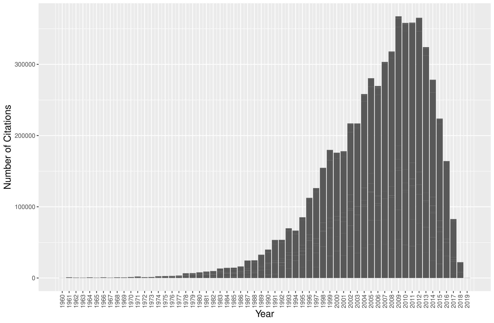  

   
*Figure 2. Upper: The temporal distribution with the number of papers derived by France-USA joint papers. Lower: The number of citations received by papers produced at these years.*
  

MAG contains field and subfield assignments to papers, which we can deploy to examine the collaboration in several scientific fields. Distinguishing between different fields, we can see in Figure 3 how the number of collaborations have evolved through the years in different disciplines, as well as their success in Figure 4. Bare in mind that a paper might belong to more than one fields. 

* We see that the majority of works are comprised of medical studies, which is quite common in academia.

* The second field is computer science and the third biology. Especially in computer science, there is a steep increase around 2010.

* Citations do not follow the same pattern, as the top cited domain is medicine, followed by biology and computer science. This is due to  the [known differences](https://www.sciencedirect.com/science/article/pii/S2405844016322800) in citation patterns among computer science and biology.

* Mathematics is the least active field in this context since publications in this area are relatively rare. Still there are some spikes of citations through the years because of important papers.
    
  

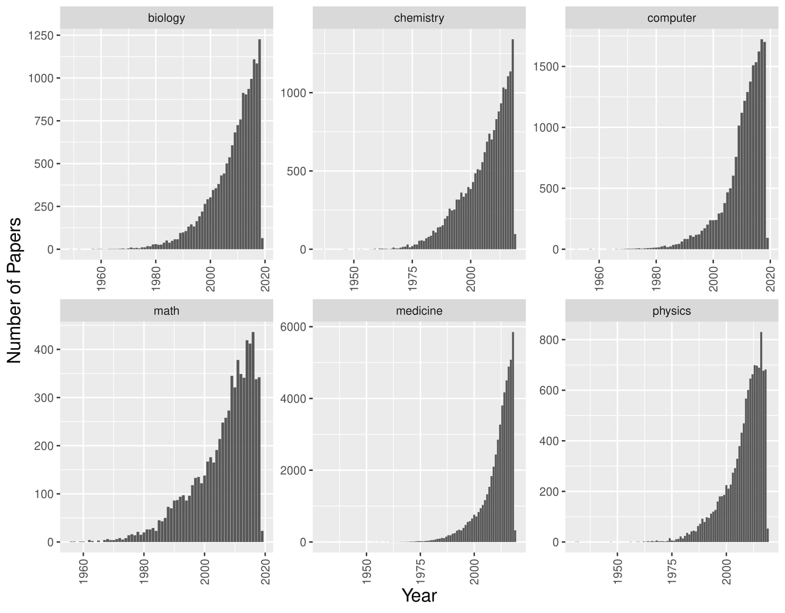  

   
*Figure 3. Number of papers produced by a French-USA collaboration per prominent scientific area. 

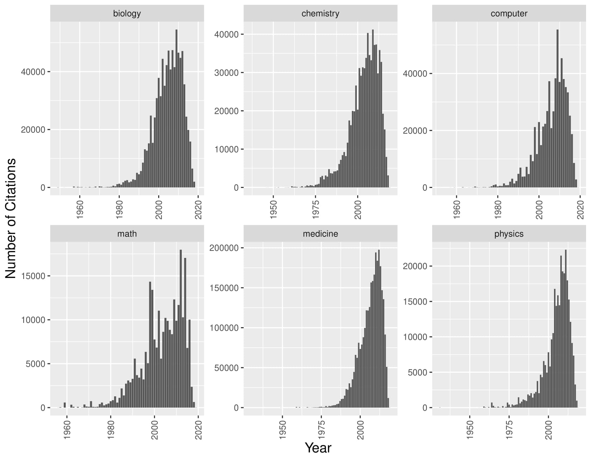  

*Figure 4.  Number of citations for the papers in Figure 3.*

  

### Top collaborations
Given a collaboration *c* among a French and a US scientific institute, the strength *P(c)* of the collaboration refers to the number of papers produced by this collaboration. The collaborations are ranked according to this strength. The most important ones are those for which the strength is above the average number of papers in all collaborations and six standard deviations of the distribution  
<!---i.e. $\{c | P(c)\geq mean({\{P(c')\}_{c'\in C}})+6sd(\{P(c')\}_{c'\in C})\}$, 
where $C$ is the set of all collaborations---->. The threshold and the density are visualized in figure Figure 5. The number of collaborations above this threshold is 492.
  

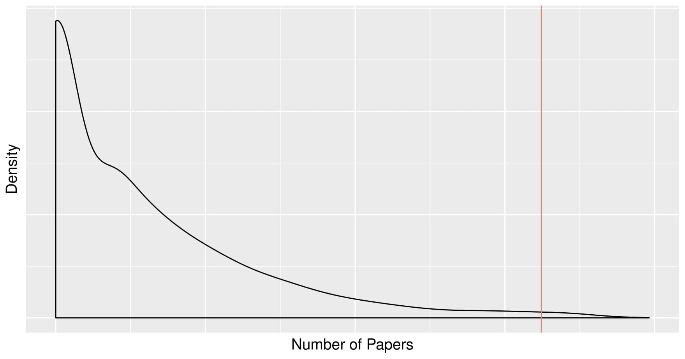  

   
*Figure 5. Density of the number of collaborations per number of papers, and the threshold to define the top collaborations.*
  

These are visualized in the map plot Figure 6. Although we can get an idea of the overall cities that collaborate mostly with each other, it is still a very perplex image to make sense of. Thus we reduce it even more, by taking the top 100 collaborations and making a weighted bipartite plot in Figure 7.

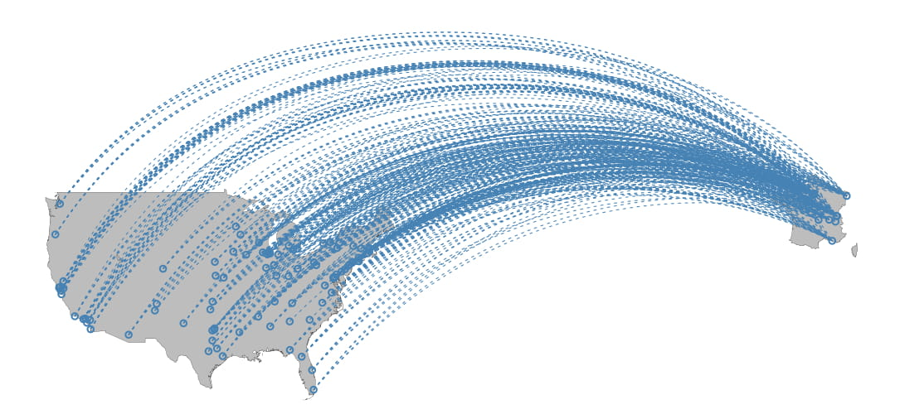  

   
*Figure 6. France-USA top collaborations.*
  

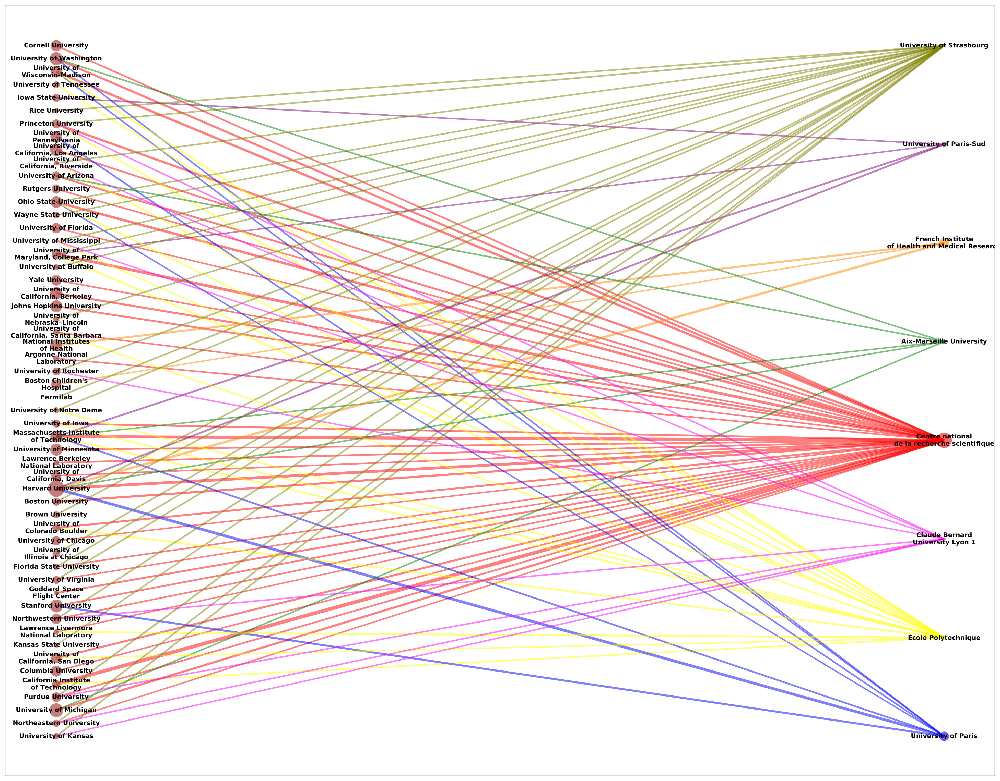  

*Figure 7. France-USA top 100 collaborations in terms of number of joint papers. Left is USA,  right is France. The size of the nodes is proportional to their number of papers, the edge width is proportional to the collaborations' strength and their color is different for each French institution.*
  

Few observations derived from a first glance on this network:
* CNRS is the institute with most collaborations, followed by Ecole Polytechnique and University of Strasbourg.
* The strength of collaboration is proportional to the width of the line connecting institutes. For instance  CNRS is highly connected with CalTech and UMD while University of Paris shows a dense collaboration with Harvard.
* The French Institute of Health and Medical Research collaborates only with two US institutes well known for their achievements in medicine, Harvard and NIH.
* The most productive French Institute is clearly CNRS, followed by University of Paris, while for the USA it is Harvard and University of Michigan.

### Top 10 collaborations
To look deeper in the most productive collaborations, we extract the top 10 in terms of absolute number of joint papers can be seen in table 2.
For each of the 10 collaborations we report their paper distribution per field, in Figure 8.
Some observations include: 

* The collaboration between CalTech and CNRS focuses mainly in math,chemistry and physics.

* The joint works of CNRS with MIT and Harvard are predominantly in medicine. In contrast, the secondary fields in MIT are computer science, chemistry, physics and math, while for Harvard biology is second and the rest follow. This makes sense because, as mentioned above, MIT is focusing more on science and technology while Harvard has a broader scope.

* University of Maryland (UMD) and CNRS seem to collaborate in a variety of disciplines, with physics being the  most dominant. 

* It is clear that the main joint papers between Harvard and University of Paris refer to medical studies. The same applied to the French Institute of Health and Medical Research, which overall might refer to joint works between these three institutes.

* CNRS has also collaborated extensively with Ohio State, Wisconsin-Madison and Michigan, especially in medicine. 

| **France**   | **USA**   |
|---|---|
|California Institute of Technology    | Centre national de la recherche scientifique (CNRS)  2678|
| Massachusetts Institute of Technology | Centre national de la recherche scientifique  (CNRS) 2226|  
| Harvard University   | Centre national de la recherche scientifique (CNRS)  2106|
| University of Maryland, College Park    | Centre national de la recherche scientifique  (CNRS) 2092 |
| Harvard University   |  University of Paris   2061|
| Ohio State University   | Centre national de la recherche scientifique (CNRS)  1840 |
| Harvard University   | French Institute of Health and Medical Research   1765   |
| University of Wisconsin-Madison      |   Centre national de la recherche scientifique (CNRS)  1742|
| Princeton University  |  Centre national de la recherche scientifique (CNRS)  1638|
| University of Michigan |  Centre national de la recherche scientifique (CNRS)  1596| 

 *Table 2. Top Frence-USA collaborations in terms of number of papers.*

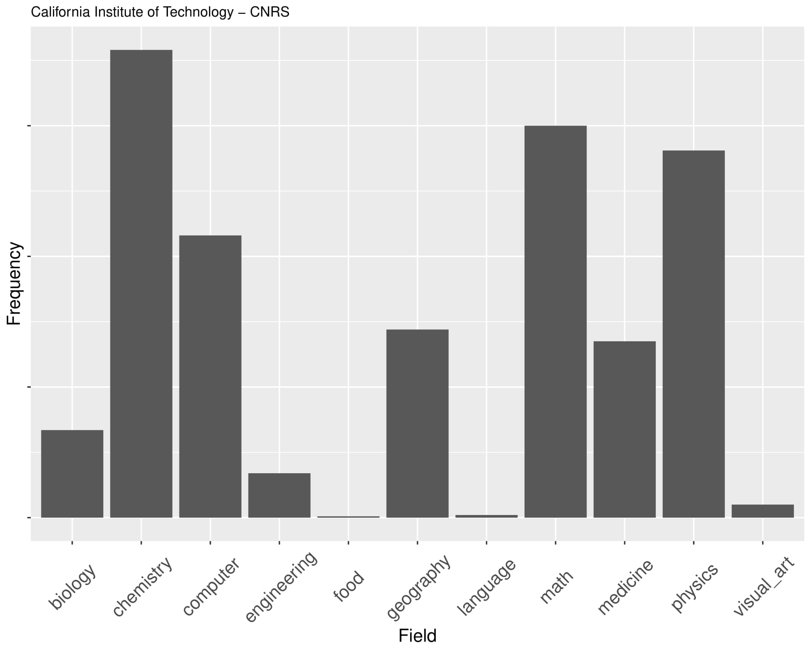  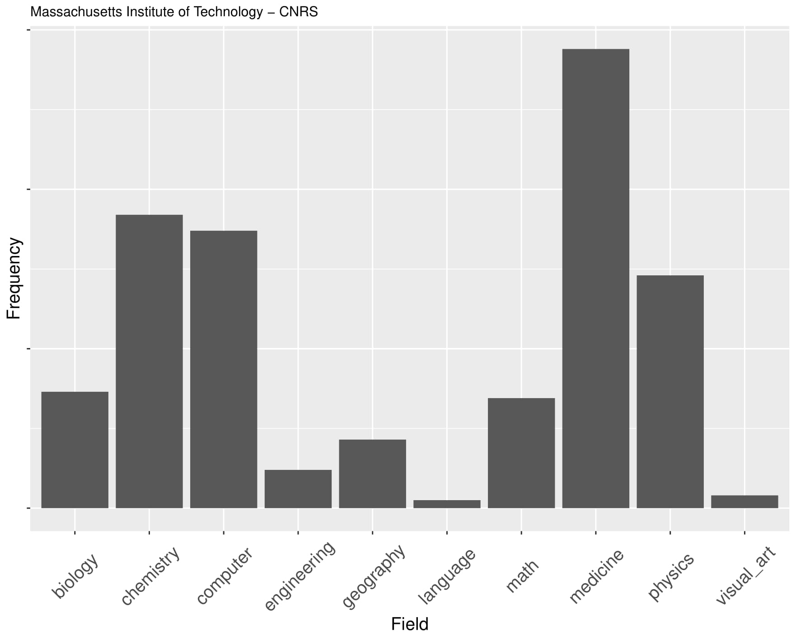  

 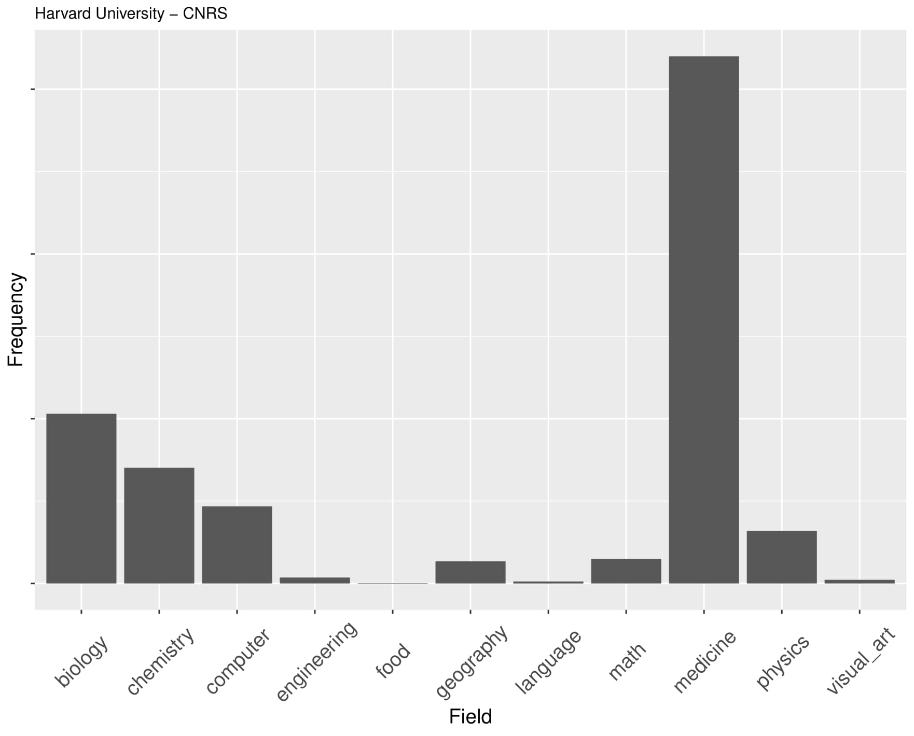  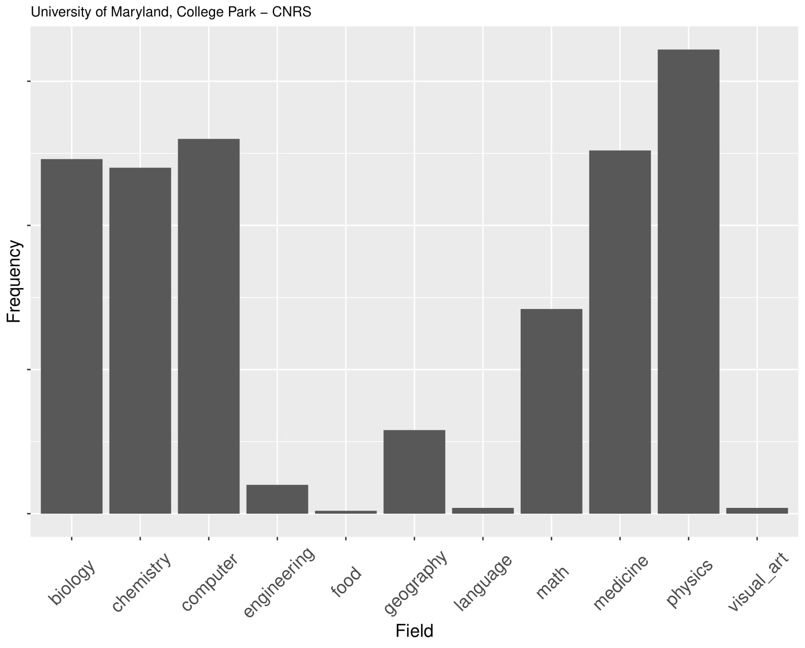 

 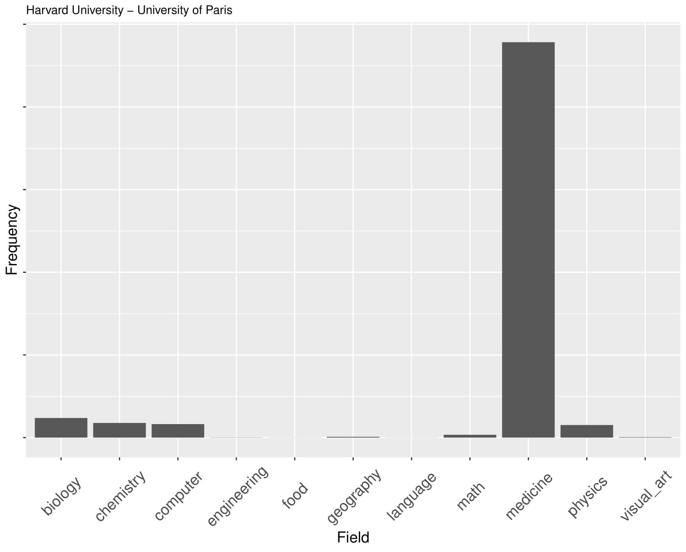  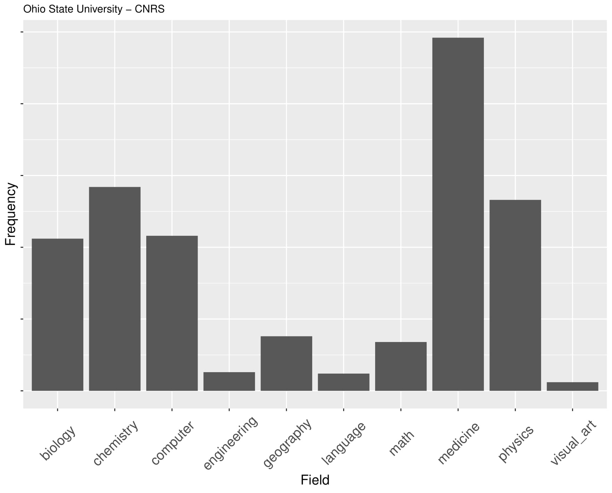  

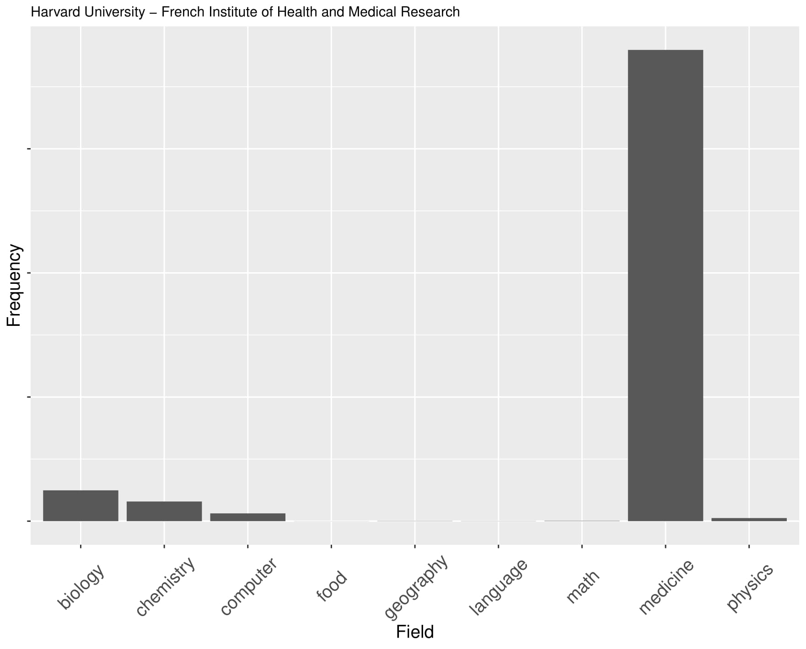  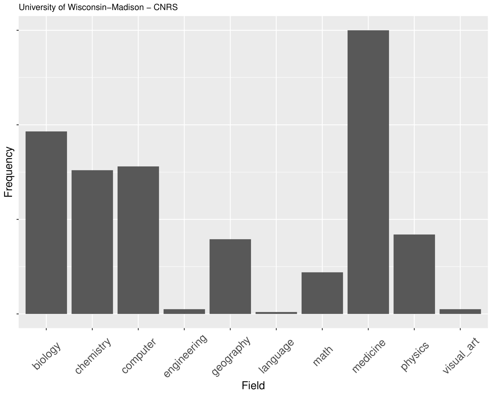  

 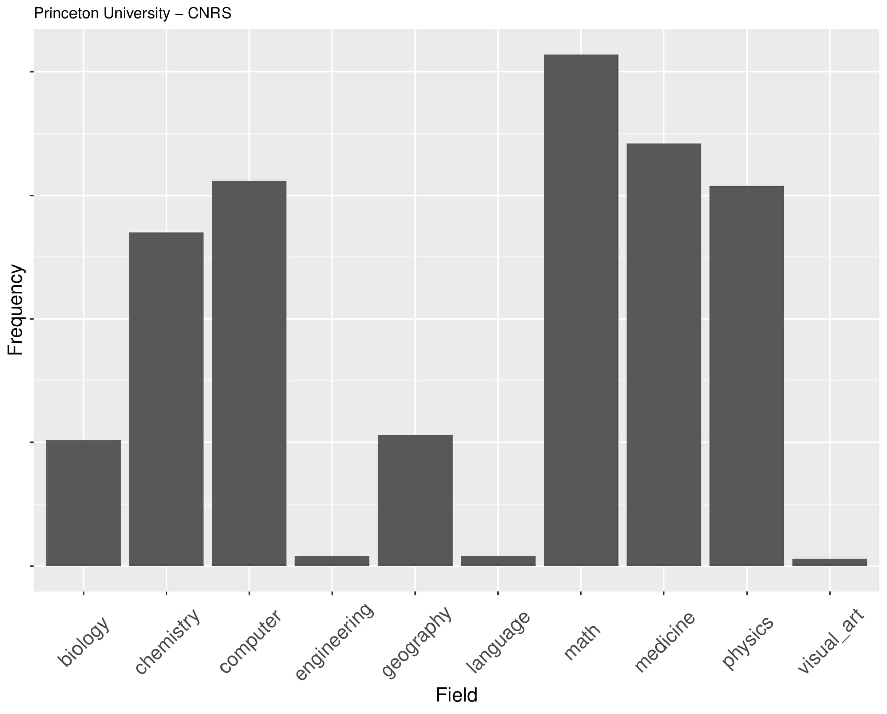 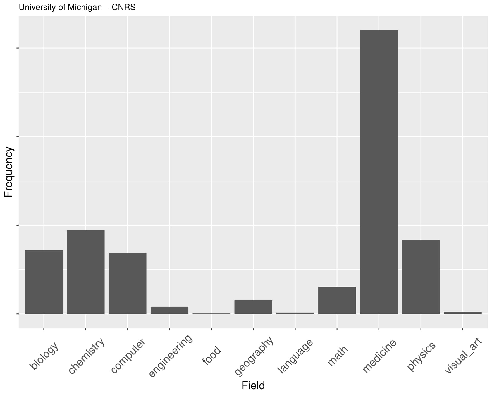  

 
*Figure 8. Number of papers produced in differnt scientific fields for the top 10 collaborations between French-USA institutes in terms of number of papers.*

## Conclusion
These initial results indicate there is an intensive and increasing scientific production in terms of joint papers and resulting citations. Overall, several new hypotheses can be tested:  

- Use [influence measures](http://graphdegeneracy.org/scientometrics/) to identify the most crucial authors, cliques or laboratories that guide the course of the majority of the  collaborations in a direct or indirect manner.
- Prediction of new collaborations based on the fields the French-US institutes belong to or the venues they publish at.
- Use of [OpenAIRE](https://zenodo.org/record/3516918#.XgZfycb0k5k) to include information about funded projects.

This analysis was performed with the guidance of my advisor [Prof. Vazirgiannis](http://www.lix.polytechnique.fr/Labo/Michalis.Vazirgiannis/), after the request of Dr. Yves Frenot, Dr. Jean-Baptiste Bordes and Maxime Benalloua from the [Office for Science and Technology](https://www.france-science.org/-Homepage-English-.html)  of the Embassy of France in the United-States, with whom we collaborated to set the hypotheses examined.
<!--- (Yves Frenot, Jean-Baptiste Bordes) 
https://www.france-science.org/-Homepage-English-.html --->

