## Covid-19 tweets
We started gathering tweets regarding Covid-19 in England on February  28, when the confirmed cases in the UK were only 15, and we continue gathering until now.
We started from England because english is the easiest language to extract knowledge from. 
We used the Twitter REST API for the most popular tweets, and have gathered up to now 115,776 unique tweets and 18,808,510 retweets of these tweets. 
The query we use to collect the tweets is: (CoronaVirus AND England) OR (CoronaVirus AND UK) OR (COVID AND England)  OR (COVID AND UK)  OR #CoronaVirusEngland OR #EnglandCoronaVirus OR #CoronaVirusEn OR #CoronaVirusUK.
About a week later, we started gathering respective data for France, Italy, and Spain and more recently for Germany and Greece. The number of tweets and retweets that we have collected for each country so far is illustrated in the following Table:

 
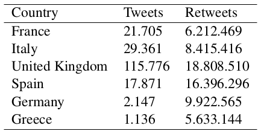 

  

These tweets do not include only country-specific languages, e.g., french for france, as we have also gathered international tweets that may refer to the spread of COVID-19 in France. Hence each set of tweets is multilingual. 

## Analyzing Tweet/Retweet/Favorites Rate
We first study the tweeting activity patterns of the users with regards to the pandemic. The left Figure below shows the number of tweets, retweets and favorites as a function of time. Clearly, users became more active from March 2020. A very large number of retweets was posted between March 10 and March 13. The right Figure shows the p-value derived by computing granger causality between the time series of the left Figure and the time series that emerge from three actual pandemic metrics, namely the number of confirmed cases, the daily increase/decrease in the number of confirmed cases (delta), and the number of deaths. The results indicate a strong relationship between the number of tweets produced (last row of heatmap) and the pandemic metrics.

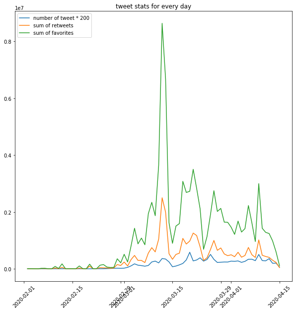  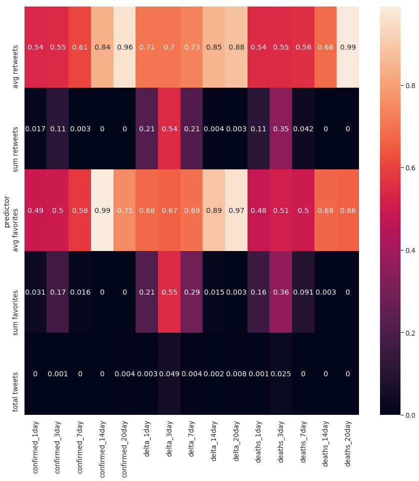 

  

                     

## Graph-based Identification of Clusters of Tweets
Given our set of unique tweets, we create a graph where nodes correspond to tweets and two nodes are connected to each other by an edge if the two tweets were both retweeted by at least a common user. Therefore, the graph does not model the textual similarity of the tweets. The increase in density of the emerging graph over time indicates how twitter activity increased and how information started to spread as the pandemic unfolds. The following six Figures show the cumulative graph of tweets of the UK dataset up to a certain date (i.e., March 3). As we can see, in all cases, the graph consists of several components which correspond to different topics and different opinions expressed by the users.

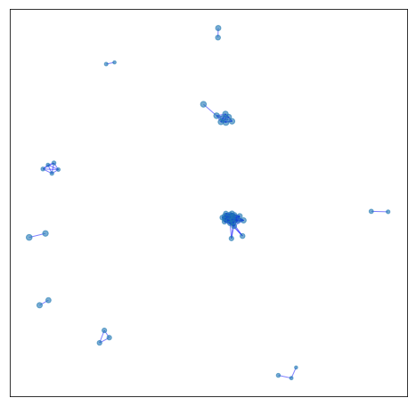 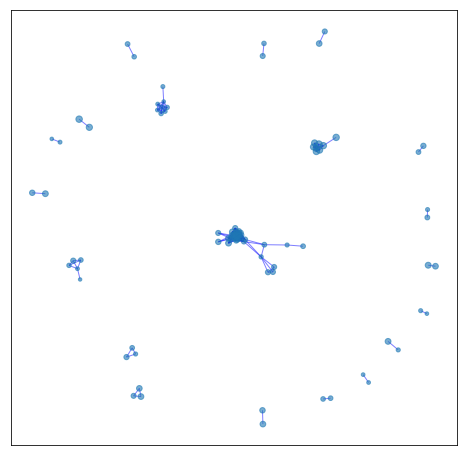  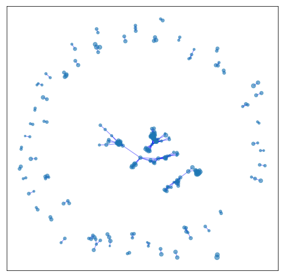
 
 <em>Feb 15, 22 & 29</em>  

 
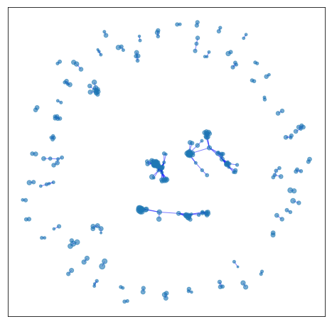 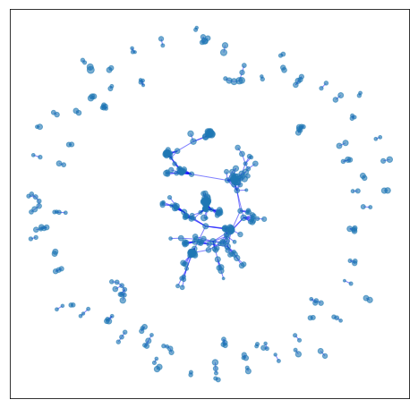  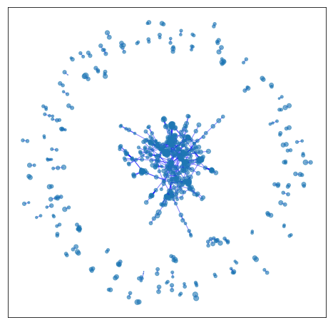
 
 <em>Mar 1, 2 & 3</em>      

For example, a more detailed view of the third graph (i.e., February 29) is given in the Figure shown below. As we can see, some of the biggest components of the graph correspond to tweets of a single user (i.e., @BBC). We also illustrate the most frequent terms of the tweets posted by these users. Interestingly, some of the tweets contain news posted by official organizations (such as BBC and DHSC of the UK government), while others correspond to personal opinions about the origin of the virus and the policies around COVID-19.  

 
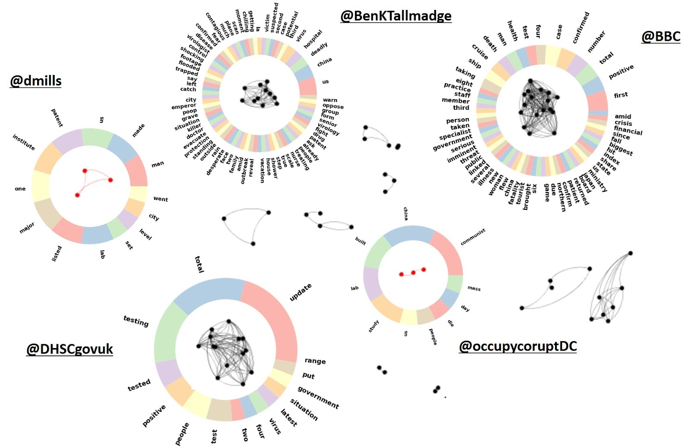 
 
 <em>Individual components and their most frequent words on February 29</em>      
  

After the 1st of March, however, COVID-19 has become a very central issue on Twitter (as shown also in Figure 1) and hence the relevant tweets’ spread increases. This translates into many users following or resharing a diverse set of opinions/news coming from different sources. Thus, a giant component is now formed, where the most popular opinions are gravitated in. Still, there are numerous individual components around it, but they mostly represent tweets of a certain person about an issue that is not (at least yet) of wide concern. 

In order to discern any type of opinion groups inside the main component, we extracted it and applied a community detection algorithm based on weighted modularity.  We next computed the word cloud of the most frequent hashtags in the tweets of each community. The word cloud is shown below. 

 
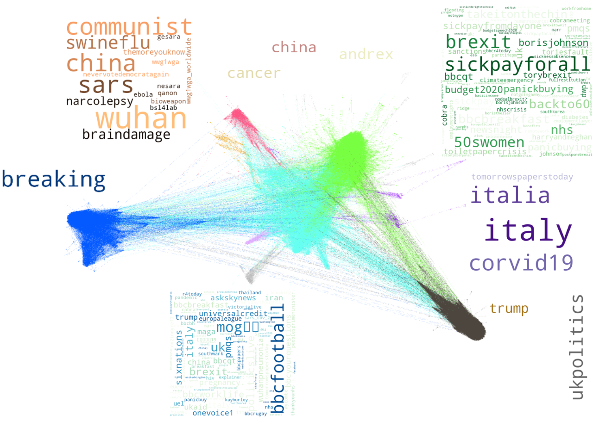 
 
 <em>Communities of the tweet graph on March 10th and their most frequent hashtags</em>      
  

             

One can see that modularity separated successfully some opinion clusters hidden within the graph. More specifically, the blue cluster consisted mostly of official news sources, where the frequent hashtags included “breaking”, ”covid-19”, “coronovirus” etc. These posts are mainly retweeted by neutral users following the news. The purple cluster concerns news around the spread of the virus in Italy, which at that time, was one of the most important subjects since Italy was severely hit by the virus. The green cluster is mainly about the policies of Britain against COVID-19, including the demands for sick pay, the complains about panic buying, the concerns around the NHS, and the Cabinet Office Briefing Rooms (COBRA) meetings that were taking place by the UK officials to plan the UK policies against the pandemic. The cyan cluster contains diverse information from multiple perspectives, that is why its position is central in the graph, and is thus shared by many communities. The most interesting community is probably the orange one (upper left), where we see lots of references to china, and opinions related to conspiracy theories (e.g., #themoreyouknow) that have been adopted by a significant portion of the public since then. More specifically, we find tweets mentioning that the virus was developed in the bsl4 lab in Wuhan, as a bioweapon. Moreover, some tweets share content that is popular amongst the right wing US population, such as political commentary (“#communist #china”), reference to the National Economic Security and Recovery Act (#nesara https://en.wikipedia.org/wiki/NESARA) and support to the conservative party (e.g. #nevervotedemocratagain). 
