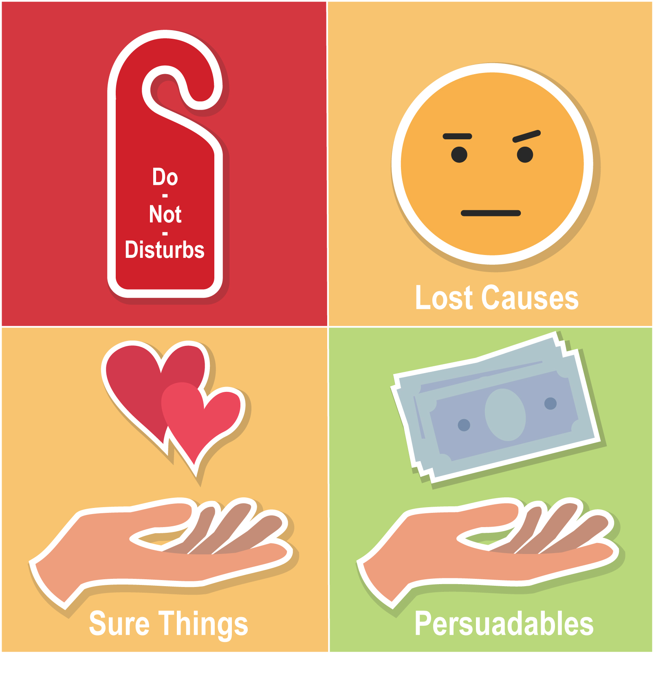

## Causal Inference and the problem of unconfoundedness
Statistical tests for causal inference are ubiquitous, from drug discovery and medical studies to social studies and online platforms, they are at the core of decision-making. 
A prevalent example is A/B testing, the de facto way to evaluate the potential of a system change before applying it in e-commerce. 

Briefly, the users are split into two random groups (treatment **T** and control **C**), the change is applied in one of them (T=1), and the difference between their response variable **Y** e.g. time spent on the system, is measured ($E[Y_t - Y_c]= \hat{Y}_t - \hat{Y}_c) to quantify the effect of the treatment. This is called the average treatment effect **ATE** or **uplift** in a randomized control trial (**RCT**). The data also includes several confounders **X** (i.e. features in machine learning) that cover different characteristics of the sample e.g. for a user, they could be the frequency and duration of visits, purchase history, demographics, etc.

The big question when you conduct such a trial and gather the responses is, did the users respond because of the treatment or because of an unobserved confounder? In other words, who are the users who responded only because they were treated? Social and medical studies rely on the Conditional Independence Assumption (CIA) to derive conclusions. CIA states that the response is independent of the treatment given the confounders i.e. $Y \perp\!\!\!\!\perp T |X $ i.e. unconfoundedness, but this is not always true, especially in open environments with several unseen confounders, like online systems.

To measure the actual effect we would ideally want to find the users in the treatment group with Y=1, that would have Y=0 if T=0, and vice versa for the control group and Y=0. Since we cannot turn back time and reassign treatments such that we get these answers, this is called a **counterfactual** scenario. The outcome of such a counterfactual scenario is what we would like to predict/estimate. One can also think of this as trying to decipher the treatment effect for each individual instead of the whole sample set, so individual treatment effect (ITE).
Loking at it from a marketing perspective, the marketers divide the users in four categories based on their potential responses to a campaign (i.e. trial):

 
  
    
  

taken from the documentation of [scikit-uplift](https://www.uplift-modeling.com/en/v0.3.0/user_guide/introduction/clients.html)
taken from the ECML Uplift modeling [tutorial](https://upliftworkshop.ipipan.waw.pl/index_2022.html). 
The **persuadables** represent the aforementioned group of users that we care about. 

Some definitions before we talk about methods:
- Conditional Average Treatment Effect (CATE): The difference between the response variable of the treated and control group in a subgroup of the data conditioned on e.g. a value of a confounder. 
- Heterogeneous treatment effect: The causal effect of the treatment can vary throughout different subsets of the samples. 
- Propensity score: The probability of a sample/group of samples being treated, given their observed confounders. Its inverse can be used to weigh the samples in ATE, which reduces the bias.
- Instrument: A variable that is connected to the independent variable (e.g. treatment) but not to the outcome, generally used to adjust the causal model for confounders.

## Uplift modeling 

In the context of a marketing campaign where we want to maximize the adoption of our product, performing a large-scale RCT could be detrimental to the revenue depending on the treatment's outcome. In contrast, if we can use a small set of data to identify the persuadable users in a consistent manner, we can use this knowledge to target specific users that are similar to the general campaign. The steps of a typical **uplift modeling** pipeline are:

1. Run a **small-scale** RCT advertising the product of the campaign in the treatment group. 
2. Gather historical data about the chosen users, their characteristics, and their responses to the interventions.
3. Combine the data from the treatment and control group, adding as a binary feature whether the sample is treated or not.
4. Train a model to estimate the response.
5. Assess the performance of the model using evaluation metrics such as uplift or uplift lift curve.
6. Use the model to other users to find out who is most likely to respond positively to the intervention.
7. Promote the product to users with the highest predicted responses.

## Double Machine Learning
Generally, ML is good for prediction but uncovering the actual causal mechanisms of the outcome from the variables is a more involved task. 
https://www.youtube.com/watch?v=eHOjmyoPCFU

% from econml
Double Machine Learning is a method for estimating (heterogeneous) treatment effects when all potential confounders/controls (factors that simultaneously had a direct effect on the treatment decision in the collected data and the observed outcome) are observed, but are either too many (high-dimensional) for classical statistical approaches to be applicable or their effect on the treatment and outcome cannot be satisfactorily modeled by parametric functions (non-parametric). Both of these latter problems can be addressed via machine learning techniques (see e.g. [Chernozhukov2016]).

The method reduces the problem to first estimating two predictive tasks:

predicting the outcome from the controls,

predicting the treatment from the controls;

Then the method combines these two predictive models in a final stage estimation so as to create a model of the heterogeneous treatment efffect. The approach allows for arbitrary Machine Learning algorithms to be used for the two predictive tasks, while maintaining many favorable statistical properties related to the final model (e.g. small mean squared error, asymptotic normality, construction of confidence intervals).

Double ML metbods because they remove the bias due to orthogonality [-](https://academic.oup.com/ectj/article/21/1/C1/5056401?login=false).
Optimal doubly robust estimation of heterogeneous causal effects [-](https://arxiv.org/pdf/2004.14497.pdf)

A simple T-learner works as followes:
1. Build a classifier $F_T$ for $P_T(Y|X)$ on the treatment sample.
2. Build a classifier $F_C$ for $P_C(Y|X)$ on the control sample.
3. Get the probabilities for a new $X'$ from both $F_C$ and $F_T$.
4. Adjust them and compute the difference that represents the uplift.

It turns out we can alleviate this bias with meta-learning.

Metalearners for estimating heterogeneous treatment effects where the X-learner is defined [-](https://www.pnas.org/content/pnas/116/10/4156.full.pdf)
Learn to predict directly the uplift:
1. Train two models $F_C$ and $F_T$ similar to above.
2. Compute diff $D_T$ between the output of the control model with the treatment group confounders $F_C(X_T)$ and treatment outcome Y_T.
3. Do the opposite for $D_C = F_T(X_C) - Y_C$
4. Build new models to $F'_C$ to predict $D_C$ given $X_C$, and same for $F'_T$. 
5. Combine the predictions of $F'_C$ and $F'_T$ (possibly weighted by inverse propensity score) to get the final outcome.

Since the X-learner focuses on learning the uplift function itself, it is better able to capture its properties e.g. smoothness, while handling the imbalance that is prevalent between treatment and control groups.

 
 
    
  
image from "Introduction to Causal ML" in KDD 2021 [tutorial](https://causal-machine-learning.github.io/kdd2021-tutorial/)

Uplift trees:
- Modify splitting criteria to maximize differences between treated/control responses

Orthogonal random forest for causal inference [-](https://epubs.siam.org/doi/pdf/10.1137/1.9781611974973.66)
uplift forests [-](https://epubs.siam.org/doi/pdf/10.1137/1.9781611974973.66) 

uplift trees figure from tutorial

A simple yet effective trick is to try and predict directly the persuadable, which means transforming the outcome class according to the definition above (like an XOR function):
$Z_i  = Y_iT_i - (1-Y_i)(1-T_i)$
Given the trained model with this class, and assuming that the treatment/control split is balanced, we can compute the ITE by adjusting the output probability:
$ITE = 2*P(Z=1|X_i)-1$
There's a straightforward explanation [here](https://www.youtube.com/watch?v=MFnOYNU5sbk).

### Experiments:
For our experiments, we compare three well-known packages that facilitate uplift learning techniques in python: 
- [EconML](https://github.com/microsoft/EconML)
- [CausalML](https://github.com/uber/causalml)  
- [SKLift](https://github.com/maks-sh/scikit-uplift)

Two datasets coming from recommender systems, with binary treatments and outcomes:
- [RetailHero](https://ods.ai/competitions/x5-retailhero-uplift-modeling/data)
- [Criteo](https://ailab.criteo.com/criteo-uplift-prediction-dataset/)

We compare S, T, and X learners based on XGBoost. Note that SKlift does not include an X-learner, so as a substitute, we use the two-model dependent data representation model that utilizes the treatment model in a T-learner that is aware of the control model predictions. It is not the same but should be close. The train/test split is set to 50%, as this is a more realistic setting for uplift modeling compared to the regular ML 80-20%.

Evaluating the uplift prediction is a relatively open question. In this case, since there are multiple datasets and methods, we rely on a scalar evaluation for comparison, but for a specific use case, plots provide a bigger picture, like in this [analysis](https://juanitorduz.github.io/uplift/).
More specifically, an intuitive way to evaluate the model is by sorting the samples based on the respective uplift predictions and computing the actual uplift per percentile. We expect the first percentiles to show a considerable increase, while the latter to drop or even be negative, as these are samples that the model predicts to have low uplift. 
To this end we used the uplift for the top 40% of the dataset, similar to Sklift's [tutorial](https://nbviewer.org/github/maks-sh/scikit-uplift/blob/master/notebooks/RetailHero_EN.ipynb). This is simple and straight forward, but we miss a potential error of the model, in case the actual uplift increases when the predicted uplift drops significantly. 
A plot of the cumulative gain from the uplift percentiles as described [here](https://www.youtube.com/watch?v=VWjsi-5yc3w&ab_channel=PyData) is more suitable, while the area under the QINI or Uplift curve may also be useful, although in my analysis they where inconsistent through methods.

 
    
  

 
 
    
  

The experiment does not provide a clear conclusion.
The logistic Regression seems to provide overall better results, with the exceptions of the Criteo dataset where the Solo model has very low accuracy

CausalML: big range of ML methods, explainability with sensitivity analysis, feature importance etc. 
Sklift: straight forward to use. lots of evaluation metrics and plots, but not so many methods.
EconML: detailed documentation with theoretical references, covers more experimental settings e.g. estimation with instruments, dynamic treatment, distinct inference methods, but it is more elaborate in use.

[code](https://github.com/geopanag/causal_inf_ml)

## Food for thought.

This was only a small part of how ML can be used for causal inference mainly in e-commerce settings. In fact causality is much more involved in most scientific studies, including block designs, instruments etc. and the role of ML in this is still nascent and exciting to explore. Some open issues I found interesting digging through ML for causal inference:
- Instead of defining the whole sample set during the experimental design, can we build it as we go? From Thompson sampling to more involved adaptive experimentation methods like [AX](https://ax.dev/), which uses bandits or Bayesian optimization, we can reduce the sample size of the experiment and still derive sound conclusions. We should be careful about the bias in sample means collected by such [methods](https://arxiv.org/pdf/1902.00746.pdf) though.
- How to design the initial trial such that is random yet informative and diverse enough to extrapolate the conclusions to the whole user base safely? Can we use some type of [optimal experimental design](https://www.jmlr.org/papers/volume22/20-1023/20-1023.pdf) methods akin to active learning, e.g. based on submodularity?
- Counterfactual estimation is generally useful in recommender systems. Specifically, the question is, given a logged dataset that is gathered by a specific recommendation policy, meaning it is inherently biased by the user's choices, how can we derive unbiased conclusions or evaluate other policies using it? This naturally entails estimating [counterfactuals]((https://counterfactual-ml.github.io/kdd2022-tutorial/)) and is referred to as [off-policy learning/evaluation](https://sites.google.com/view/practical-bandits-tutorial/).
- In social or online experiments there are connections that define potential confounders e.g. due to friendship spillover effects in social media or collaborative filtering in marketplaces, which makes the experiments much more tricky. We can address the interference caused by the network with [graph cluster randomization](https://dl.acm.org/doi/pdf/10.1145/2487575.2487695?casa_token=dBLX5rN7_kUAAAAA:_TMwA-TK5LlIA6ivgMmEeutYyy4kktMkBg5P0MbQRnhbuFOyliiquXtBzchk7jwOGl_R24mpN26o). We can also learn to predict counterfactuals controlling for both, the confounders and the connections using [hypergraph neural networks](https://arxiv.org/pdf/2207.04049.pdf)
- Are the current uplift modeling assumptions valid in real-world applications? An insightful [critique](https://arxiv.org/pdf/2304.10900.pdf) on AB testing with ML.
- E-commerce platforms tend to have large-scale heterogeneous data, can we pair more elaborate neural architectures with uplift modeling techniques to improve them?

## Resources
A [survey]https://web.archive.org/web/20201111172707id_/http://proceedings.mlr.press/v67/gutierrez17a/gutierrez17a.pdf and a [course](https://www.youtube.com/watch?v=Z0ZcsxI-HTs&list=PLxq_lXOUlvQAoWZEqhRqHNezS30lI49G-&index=3).

Tutorials
- https://github.com/vveitch/causality-tutorials/tree/main
- https://www.youtube.com/watch?v=VWjsi-5yc3w 
- https://www.youtube.com/watch?v=eHOjmyoPCFU
- https://causal-machine-learning.github.io/kdd2021-tutorial/

Workshops
- https://upliftworkshop.ipipan.waw.pl/ 
- https://sites.google.com/view/consequences2023/home

Books
- [Causal Inference and Discovery in Python:](https://www.amazon.fr/dp/1804612987?utm_term=2023_06&utm_campaign=causalpython_links&utm_medium=button&ref_=as_li_ss_tl&language=en_US&utm_source=webpage&linkCode=gg2&linkId=842a3ff0187e800a338f20d3ce81352b&tag=alxndrmlk00-20)

Finally, some interesting (and more general) papers I did not include above.
[Disentangling Causal Effects from Sets of Interventions in the Presence of Unobserved Confounders](https://proceedings.neurips.cc/paper_files/paper/2022/file/b29ec434e049fb96f3c4245a405ee976-Paper-Conference.pdf) 
[Counterfactual Explanations in Sequential Decision Making Under Uncertainty](https://proceedings.neurips.cc/paper/2021/file/fd0a5a5e367a0955d81278062ef37429-Paper.pdf)
[Machine Learning Estimation of Heterogeneous Treatment Effects with Instruments](https://proceedings.neurips.cc/paper/2019/file/3b2acfe2e38102074656ed938abf4ac3-Paper.pdf)
[Adapting Neural Networks for the Estimation of Treatment Effects (Draggonnet)](https://proceedings.neurips.cc/paper_files/paper/2019/file/8fb5f8be2aa9d6c64a04e3ab9f63feee-Paper.pdf)
[Causal Effect Variational Autoencoder](https://proceedings.neurips.cc/paper/2017/file/94b5bde6de888ddf9cde6748ad2523d1-Paper.pdf) 
[Off-Policy Evaluation for Large Action Spaces via Embeddings](https://arxiv.org/pdf/2202.06317.pdf)
[Relating Graph Neural Networks to Structural Causal Models](https://arxiv.org/pdf/2109.04173.pdf)
