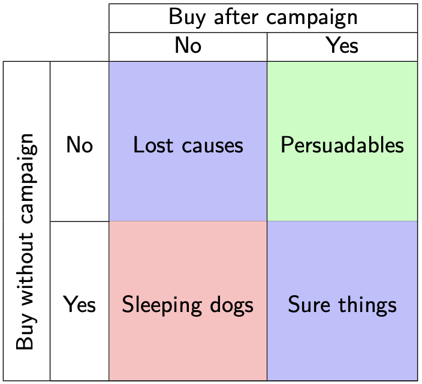
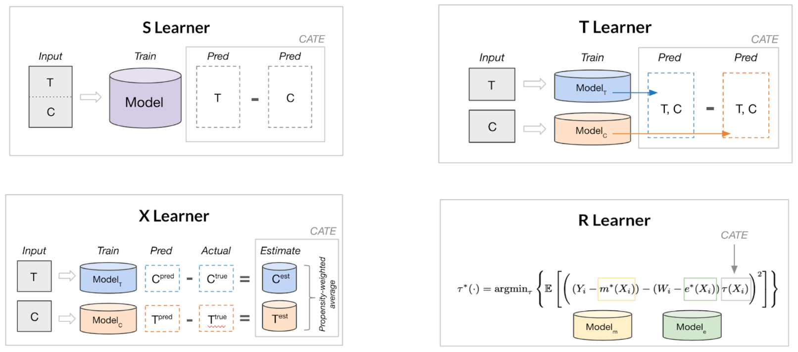
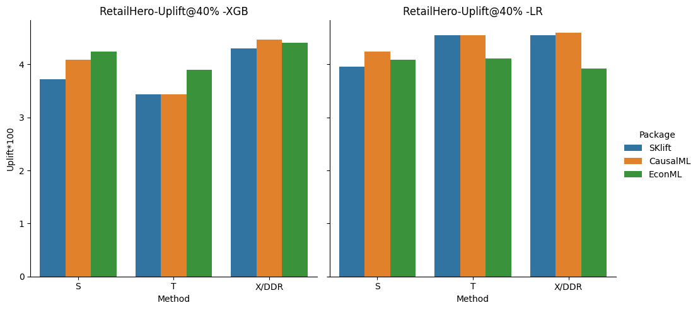
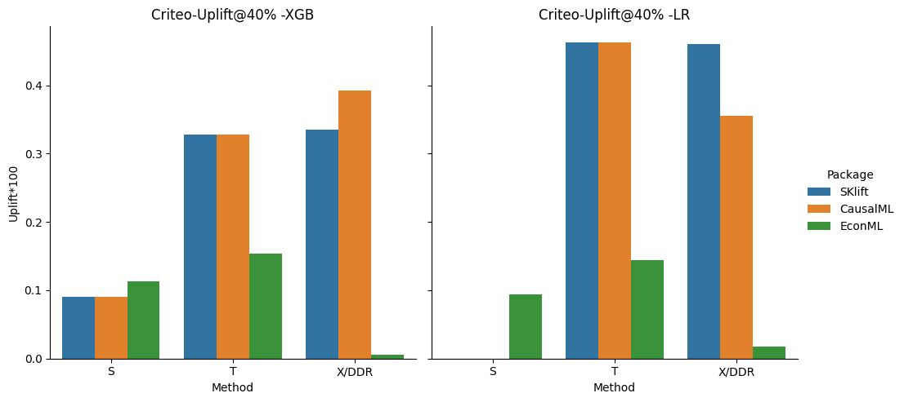

## Causal inference and the problem of unconfoundedness
Statistical tests for causal inference are ubiquitous, from drug discovery and medical studies to social studies and online platforms, they are at the core of decision-making. 
A prevalent example is A/B testing, the de facto way to evaluate the potential of a system change before applying it in e-commerce. 

Briefly, the users are split into two random groups (treatment **T** and control **C**), the change is applied in one of them (T=1), and the difference between their response variable **Y** e.g. time spent on the system, is measured ($E[Y_t - Y_c]= \hat{Y}_t - \hat{Y}_c$)$ to quantify the effect of the treatment. This is called the average treatment effect **ATE** or **uplift** in a randomized control trial (**RCT**). The data also includes several confounders **X** (i.e. features in machine learning) that cover different characteristics of the sample e.g. for a user, they could be the frequency and duration of visits, purchase history, demographics, etc.

The big question when you conduct such a trial and gather the responses is, did the users respond because of the treatment or because of an unobserved confounder? In other words, who are the users who responded only because they were treated? Social and medical studies rely on the Conditional Independence Assumption (CIA) to derive conclusions. CIA states that the response is independent of the treatment given the confounders i.e. unconfoundedness, but this is not always true, especially in open environments with several unseen confounders, like online systems.

To measure the actual effect we would ideally want to find the users in the treatment group with Y=1, that would have Y=0 if T=0, and vice versa for the control group and Y=0. Since we cannot turn back time and reassign treatments such that we get these answers, this is called a **counterfactual** scenario. The outcome of such a counterfactual scenario is what we would like to predict/estimate. One can also think of this as trying to decipher the treatment effect for each individual instead of the whole sample set, so individual treatment effect (ITE).
Loking at it from a marketing perspective, the marketers divide the users in four categories based on their potential responses to a campaign (i.e. trial):

 
 

 <em>Taken from the ECML Uplift modeling [tutorial](https://upliftworkshop.ipipan.waw.pl/index_2022.html)</em>    
  

The **persuadables** represent the aforementioned group of users that we care about, and we can use machine learning to uncover them. 

[//]: # Some brief definitions before we talk about methodology:
[//]: # - Conditional Average Treatment Effect (CATE): The difference between the response variable of the treated and control group in a subgroup of the data conditioned on e.g. a value of a confounder. 
[//]: # - Heterogeneous treatment effect: The causal effect of the treatment that can vary throughout different subsets of the samples. 
[//]: # - Propensity score: The probability of a sample/group of samples being treated, given their observed confounders. Its inverse can be used to weigh the samples in **ATE**, which reduces the bias.
[//]: # - Instrument: A variable that is connected to the independent variable (e.g. treatment) but not to the outcome, generally used to adjust the causal model for confounders.

## Uplift modeling 

In the context of a marketing campaign where we want to maximize the adoption of our product, performing a large-scale RCT could be detrimental to the revenue depending on the treatment's outcome. In contrast, if we can use a small set of data to identify the persuadable users in a consistent manner, we can use this knowledge to target specific users that are similar to the general campaign. The steps of a typical **uplift modeling** pipeline are:

1. Run a **small-scale** RCT advertising the product of the campaign in the treatment group. 
2. Gather historical data about the chosen users, their characteristics, and their responses to the interventions.
3. Combine the data from the treatment and control group, adding as a binary feature whether the sample is treated or not $X' = [X,T]$.
4. Train a model to estimate the response $F(X') = Y$.
5. Assess the performance of $F$ using either standard cross-valdiation or uplift evaluation metrics which we briefly describe below.
6. Use $F$ to get the predicted responses for users outside the campaign.
7. Find out who is most likely to respond positively to the intervention and promote the product to them.

## Meta and Double Learning
The problem with having one function for both treatment and control groups is that we expect these data to exhibit some heterogeneity, both in the confounders and in the outcome variable. 
We can capture such potential differences by using separate models for treated and control groups. This means each model will be able to adapt easier to the patterns of the subsets, which we expect to differ, making it more flexible and more robust. 
To use this we can simply first predict the outcome of the control and the treatment samples seperately, and then subtract them to get an **ATE** prediction.
The method is called a T-learner:
1. Build a classifier $F_T$ for $P_T(Y\|X)$ on the treatment sample.
2. Build a classifier $F_C$ for $P_C(Y\|X)$ on the control sample.
3. Get the probabilities for a new $X'$ from both $F_C$ and $F_T$.
4. Adjust them and compute the difference that represents the uplift.

Another problem here is that imbalances between the groups can induce bias in the final model. It turns out we can alleviate it with [meta-learning](https://www.pnas.org/content/pnas/116/10/4156.full.pdf), enter the X-learner.
1. Train two models $F_C$ and $F_T$ similar to above.
2. Compute diff $D_T$ between the output of the control model with the treatment group confounders $F_C(X_T)$ and treatment outcome $Y_T$.
3. Do the opposite for $D_C = F_T(X_C) - Y_C$
4. Build new models to $F'_C$ to predict $D_C$ given $X_C$, and same for $F'_T$. 
5. Combine the predictions of $F'_C$ and $F'_T$ (possibly weighted by inverse propensity score) to get the final outcome.

Since the X-learner focuses on learning the uplift function itself, it is better able to capture its properties e.g. smoothness, while handling the imbalance that is prevalent between treatment and control groups.

 

     
 <em>Image from "Introduction to Causal ML" in KDD 2021 [tutorial](https://causal-machine-learning.github.io/kdd2021-tutorial/)</em>
  

Apart from counterfactual prediction, ML can assist in hypothesis testing due to its resiliense with high dimensional confounders, which hinders classical statistical approaches based on parametric functions.
However uncovering the actual causal mechanisms of the outcome is a more involved task compared to prediction, hence using solely ML does not suffice.
If we assume that indeed all confounders are observed, we can adjust the causal inference mechanism in in order to use ML to correct the [bias of the experiment](https://academic.oup.com/ectj/article/21/1/C1/5056401?login=false).
The aim in this case is to retrieve a more clear estimation of the treatment effect, and the main idea is to use two ML methods to estimate the propensity score and the outcome. Subsequently, use these estimates, along with K-fold partitioning of the samples, to mitigate both the treatment assignment and the outcome estimation bias during the **ATE** estimation.
This decomposition uses ML to handle the confounders effectively, while keeping the original approach and its advantages, not to mention it has theoretically faster rates of converges to the [optimum](https://www.youtube.com/watch?v=eHOjmyoPCFU).

Finally, some alternative ML for causal inference which we re not going to cover in this post:
- [Orthogonal Forests](https://epubs.siam.org/doi/pdf/10.1137/1.9781611974973.66): Modify splitting criteria to maximize differences between treated/control responses.
- Predict directly the persuadables by transforming the outcome class according to the definition above (like an XOR function): $Z_i  = Y_iT_i - (1-Y_i)(1-T_i)$ Assuming that the treatment/control split is balanced, we can compute the ITE by adjusting the output probability: $ITE = 2*P(Z=1\|X_i)-1$. There's a straightforward explanation [here](https://www.youtube.com/watch?v=MFnOYNU5sbk).

### Experiments:
For our experiments, we compare three well-known packages that facilitate uplift learning techniques in python, using two datasets coming from recommender systems, with binary treatments and outcomes: [SKlift](https://github.com/maks-sh/scikit-uplift), [CausalML](https://github.com/uber/causalml) and [EconML](https://github.com/microsoft/EconML).

| Dataset                                  | Treatment | Control  | Y=1    | Y=0      |
|------------------------------------------|:---------:|:--------:|:------:|:--------:|
| [RetailHero](https://ods.ai/competitions/x5-retailhero-uplift-modeling/data) |  91,543   |  90,950  | 117,615|   64,878   |
| [Criteo](https://ailab.criteo.com/criteo-uplift-prediction-dataset/)         |11,882,655 | 2,096,937| 40,774 |13,938,818 |

We compare **S**, **T**, and **X** learners based on XGBoost (**XGB**) and Logistic Regression (**LR**). The propensity model of the X-learner is by default an XGBoost classifier. Note that SKlift does not include an X-learner, so as a substitute, we use the two-model dependent data representation (**DDR**) model that utilizes the treatment model in a T-learner that is aware of the control model predictions. The train/test split is set to 50%, as this is a more realistic setting for uplift modeling compared to the regular ML 80-20%.

Evaluating the uplift prediction is a relatively open question. In this case, since there are multiple datasets and methods, we rely on a scalar evaluation for comparison, but for a specific use case, plots provide a bigger picture, like in this [analysis](https://juanitorduz.github.io/uplift/).
More specifically, an intuitive way to evaluate the model is by sorting the samples based on the respective uplift predictions and computing the actual uplift per percentile. We expect the first percentiles to show a considerable increase, while the latter to drop or even be negative, as these are samples that the model predicts to have low uplift. 

To this end we used the uplift for the top 40% of the dataset, similar to SKlift's [tutorial](https://nbviewer.org/github/maks-sh/scikit-uplift/blob/master/notebooks/RetailHero_EN.ipynb). This is simple and straight forward, but we miss a potential error of the model, in case the actual uplift increases when the predicted uplift drops significantly. 
A plot of the cumulative gain from the uplift percentiles as described [here](https://www.youtube.com/watch?v=VWjsi-5yc3w&ab_channel=PyData) is more suitable. The area under the QINI or Uplift curve can also be useful, although in my analysis they where inconsistent through methods.

 

    
  

 
 
    
  

As we expected the X-learner outperforms the other methods but not predominantly. The result is more clear for RetailHero, where the performance increases with the complexity of the method for both, **XGB** and **LR** classifiers.
The CausalML **X** seems to provide the best overall performance in this case for both, **XGB** and **LR**, while EconML and SKlift have competitive results, specially for **S** and **T**.

The large-scale size and the major imbalance between treatment/control renders Criteo a much harder baseline, and challenges the scalability of the methods. 
This happens to the CausalML and SKlift case for **S** where the **LR** fails to converge. On the other hand EconML always provides an uplift but is quite diminished, possibly due to the dataset's scale.
Overall the **T** and **LR** method seems to perform better in this case, and SKlift provides overall higher uplift.  

The code to reproduce the analysis can be found in [github](https://github.com/geopanag/causal_inf_ml).
Apart from the experiments, I would sum up the key takeaways from using the three packages as:
- CausalML: big range of ML methods, explainability with sensitivity analysis, feature importance etc. 
- EconML: detailed documentation, orthogonal double ML, more experimental settings e.g. instruments, dynamic treatment etc.
- Sklift: straight forward to use, numerous evaluation metrics and plots, but not so many methods.

## Food for thought.
This was only a small part of how ML can be used for causal inference mainly in e-commerce settings. In fact causality is much more involved in most scientific studies, including block designs, instruments etc. and the role of ML in this is still nascent and exciting to explore. Some interesting open issues are:
- Instead of defining the whole sample set during the experimental design, can we build it as we go? From Thompson sampling to more involved adaptive experimentation methods like [AX](https://ax.dev/), which uses bandits or Bayesian optimization, we can reduce the sample size of the experiment and still derive sound conclusions. We should be careful about the bias in sample means collected by such [methods](https://arxiv.org/pdf/1902.00746.pdf) though.
- How to design the initial trial such that is random yet informative and diverse enough to extrapolate the conclusions to the whole user base safely? Can we use some type of [optimal experimental design](https://www.jmlr.org/papers/volume22/20-1023/20-1023.pdf) methods akin to active learning, e.g. based on submodularity?
- Counterfactual estimation is generally useful in recommender systems. Specifically, the question is, given a logged dataset that is gathered by a specific recommendation policy, meaning it is inherently biased by the user's choices, how can we derive unbiased conclusions or evaluate other policies using it? This naturally entails estimating [counterfactuals]((https://counterfactual-ml.github.io/kdd2022-tutorial/)) and is referred to as [off-policy learning/evaluation](https://sites.google.com/view/practical-bandits-tutorial/).
- In social or online experiments there are connections that define potential confounders e.g. due to friendship spillover effects in social media or collaborative filtering in marketplaces, which makes the experiments much more tricky. We can address the interference caused by the network with [graph cluster randomization](https://dl.acm.org/doi/pdf/10.1145/2487575.2487695?casa_token=dBLX5rN7_kUAAAAA:_TMwA-TK5LlIA6ivgMmEeutYyy4kktMkBg5P0MbQRnhbuFOyliiquXtBzchk7jwOGl_R24mpN26o). We can also learn to predict counterfactuals controlling for both, the confounders and the connections using [hypergraph neural networks](https://arxiv.org/pdf/2207.04049.pdf).
- Are the current uplift modeling assumptions valid in real-world applications? An insightful [critique](https://arxiv.org/pdf/2304.10900.pdf) on AB testing with ML.
- E-commerce platforms tend to have large-scale heterogeneous data, can we pair more elaborate neural architectures with uplift modeling techniques to improve them?

## Resources
A [survey](https://web.archive.org/web/20201111172707id_/http://proceedings.mlr.press/v67/gutierrez17a/gutierrez17a.pdf) and a [course](https://www.youtube.com/watch?v=Z0ZcsxI-HTs&list=PLxq_lXOUlvQAoWZEqhRqHNezS30lI49G-&index=3).

Tutorials
- https://github.com/vveitch/causality-tutorials/tree/main
- https://www.youtube.com/watch?v=VWjsi-5yc3w 
- https://www.youtube.com/watch?v=eHOjmyoPCFU
- https://causal-machine-learning.github.io/kdd2021-tutorial/

Workshops
- https://upliftworkshop.ipipan.waw.pl/ 
- https://sites.google.com/view/consequences2023/home

Books
- [Causal Inference and Discovery in Python:](https://www.amazon.fr/dp/1804612987?utm_term=2023_06&utm_campaign=causalpython_links&utm_medium=button&ref_=as_li_ss_tl&language=en_US&utm_source=webpage&linkCode=gg2&linkId=842a3ff0187e800a338f20d3ce81352b&tag=alxndrmlk00-20)

Interesting (and more general) papers I did not include above
- [Optimal doubly robust estimation of heterogeneous causal effects](https://arxiv.org/pdf/2004.14497.pdf)
- [Disentangling Causal Effects from Sets of Interventions in the Presence of Unobserved Confounders](https://proceedings.neurips.cc/paper_files/paper/2022/file/b29ec434e049fb96f3c4245a405ee976-Paper-Conference.pdf) 
- [Counterfactual Explanations in Sequential Decision Making Under Uncertainty](https://proceedings.neurips.cc/paper/2021/file/fd0a5a5e367a0955d81278062ef37429-Paper.pdf)
- [Machine Learning Estimation of Heterogeneous Treatment Effects with Instruments](https://proceedings.neurips.cc/paper/2019/file/3b2acfe2e38102074656ed938abf4ac3-Paper.pdf)
- [Adapting Neural Networks for the Estimation of Treatment Effects (Draggonnet)](https://proceedings.neurips.cc/paper_files/paper/2019/file/8fb5f8be2aa9d6c64a04e3ab9f63feee-Paper.pdf)
- [Causal Effect Variational Autoencoder](https://proceedings.neurips.cc/paper/2017/file/94b5bde6de888ddf9cde6748ad2523d1-Paper.pdf) 
- [Off-Policy Evaluation for Large Action Spaces via Embeddings](https://arxiv.org/pdf/2202.06317.pdf)
- [Relating Graph Neural Networks to Structural Causal Models](https://arxiv.org/pdf/2109.04173.pdf)
